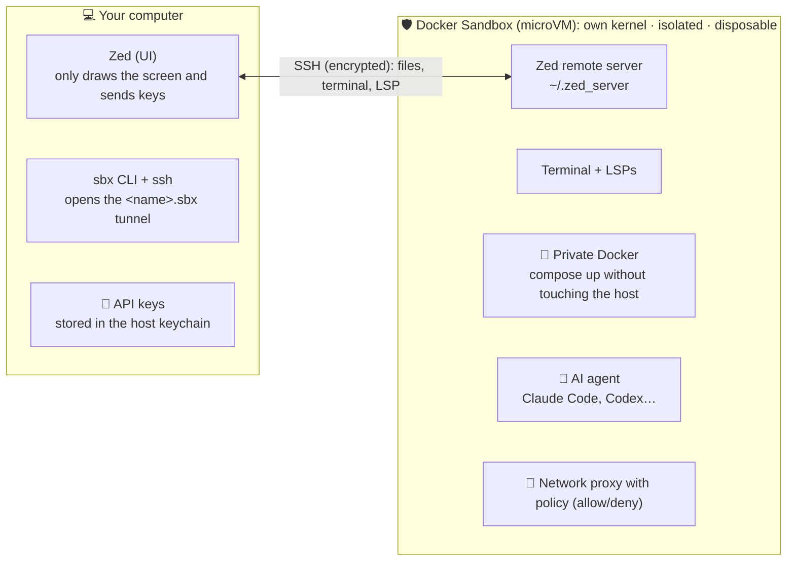
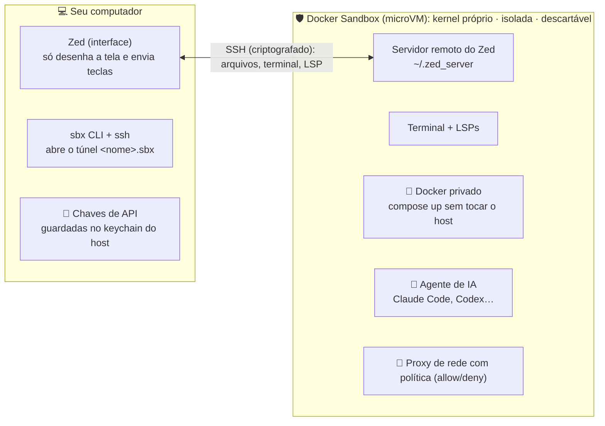

<p align="center">
  
  &nbsp;&nbsp;&nbsp;&nbsp;
  
  &nbsp;&nbsp;&nbsp;&nbsp;
  
</p>

<h1 align="center">Lab · Sandboxes + Zed</h1>

<p align="center">
  <b>Docker Sandboxes · Zed · Claude Code</b><br>
  <a href="#-english">🇺🇸 English</a> · <a href="#-português">🇧🇷 Português</a>
</p>

<p align="center">
  
  
  
  
</p>

> Interactive version of this lab (OS switcher, copy buttons, checklists): open [`lab-docker-sandboxes-zed.html`](lab-docker-sandboxes-zed.html) in your browser.
> Versão interativa (seletor de sistema, botões de copiar, checklists): abra [`lab-docker-sandboxes-zed.html`](lab-docker-sandboxes-zed.html) no navegador.

---

# 🇺🇸 English

## Lab: coding with Zed inside a Docker Sandbox

The editor stays on your computer. The code, the terminal, Docker and the AI agent stay locked inside a disposable microVM, first locally and then in the cloud. This script lets you run the lab and record the class at the same time.

`⏱️ Lab: ~60 min` · `🎬 Final video: ~15–18 min` · `🧑‍🎓 Level: beginner` · `💻 macOS · Windows · Linux` · `🔧 sbx CLI · Zed · SSH · Docker Compose`

### Contents
0. [What we will build (and why)](#0-what-we-will-build-and-why)
1. [Prerequisites](#1-prerequisites)
2. [Install sbx and Zed, sign in, pick the network policy](#2-install-sbx-and-zed-sign-in-pick-the-network-policy)
3. [Create the sample project](#3-create-the-sample-project-captains-dashboard)
4. [Create the sandbox and enable SSH](#4-create-the-sandbox-and-enable-ssh-local)
5. [Connect Zed to the sandbox](#5-connect-zed-to-the-sandbox-local)
6. [Run the app with Docker Compose](#6-run-the-app-with-docker-compose-inside-the-sandbox-local)
7. [Put an AI agent to work](#7-put-an-ai-agent-to-work-and-watch-it-in-zed-local)
8. [Same experience, now in the cloud](#8-same-experience-now-in-the-cloud-cloud)
9. [Cleanup and troubleshooting](#9-cleanup-and-troubleshooting)
10. [Write down what worked and what didn't](#10-write-down-what-worked-and-what-didnt)
11. [🎬 Recording script, scene by scene](#-recording-script-scene-by-scene)

---

### 0. What we will build (and why)

Before typing any command, understand the "shape" of the lab. This becomes the first minute of your class.



**🧠 Explaining the terms**
- **Sandbox**: a closed environment where something can make a mess without breaking anything else.
- **microVM**: a minimal virtual machine that boots in seconds and has its own kernel (the "core" of the system). It is more isolated than a regular container.
- **SSH**: a secure way to control another computer through the terminal. Zed uses SSH to "get inside" the sandbox.

**🎯 The core message of the class**
"Let the AI agent work with full freedom (install packages, run Docker, delete files) without risking your computer. And keep using the fast editor you already like."

**Lab roadmap**

| Part | What you do | Where it runs |
|---|---|---|
| 1–2 | Install `sbx` and Zed, sign in, pick the network policy | Your computer |
| 3 | Create a tiny Node.js app with Dockerfile + Compose | Your computer |
| 4–5 | Create the sandbox and connect Zed over SSH | LOCAL |
| 6 | Run the app with Docker Compose inside the sandbox | LOCAL |
| 7 | Put an AI agent to edit the code while you watch in Zed | LOCAL |
| 8 | Repeat the connection on a Cloud Sandbox (US$ 250 credit) | CLOUD |
| 9–10 | Cleanup, common problems and feedback for the Docker team | — |
| 🎬 | Scene-by-scene recording script + checklist | — |

> [!NOTE]
> **An honest fact for your class:** the official Docker docs have ready-made guides for VS Code, Cursor, Claude Desktop, ChatGPT and others, but **no Zed-specific guide** yet. The integration works because any editor with "remote development over SSH" can use the `<name>.sbx` address. That is exactly the content gap your post fills.

---

### 1. Prerequisites

- [ ] Docker account (free), used by `sbx login`
- [ ] **Zed** installed, version **0.159 or newer** (remote development over SSH)
- [ ] SSH client: built into macOS and Linux; on Windows, the "OpenSSH Client" (optional Windows feature)
- [ ] Docker Sandboxes `sbx` CLI (installed in Part 2). **Docker Desktop is not required.**
- [ ] (Part 7) An Anthropic API key *or* a Claude subscription for the agent
- [ ] (Part 8) A Docker Agentic Platform signup with a card, for the cloud and the promotional credit
- [ ] Recording software (OBS Studio, ScreenFlow, Camtasia…) tested

> [!WARNING]
> **Old vs. new command:** if you used `docker sandbox run ...` (integrated with Docker Desktop), it is **deprecated**. The current way is the standalone `sbx` CLI. This whole class uses `sbx`.

---

### 2. Install sbx and Zed, sign in, pick the network policy

#### 2.1 Install the `sbx` CLI

**🪟 Windows (PowerShell)**
```powershell
winget install Docker.sbx
# close and reopen PowerShell so it sees the new command
sbx version
```

**🍎 macOS (Homebrew)**
```bash
brew trust docker/tap && brew install docker/tap/sbx
sbx version
```

**🐧 Linux (Ubuntu)**
```bash
curl -fsSL https://get.docker.com | sudo REPO_ONLY=1 sh
sudo apt-get install docker-sbx
sbx version
```

✅ **Expected:** `sbx version` prints a version number. SSH needs **0.37.0 or newer**; the cloud editor flow needs **0.45.0 or newer**.

#### 2.2 Sign in with your Docker account (same on every OS)
```bash
sbx login
```
✅ **Expected:** the browser opens, you confirm, and the terminal says you are signed in.

> [!WARNING]
> **Personal account × organization:** the cloud credits (US$ 250) live on your **personal account**, not on the organization. Sign in to `sbx` with the personal account. To check which account is active, run `sbx setup ssh` and read the `signed in as <user>` line. If it is wrong: `sbx logout`, then `sbx login`.

#### 2.3 Pick the network policy
The network policy is the sandbox's "front desk": it decides which sites the code inside can reach. For the class, use **Balanced**, the recommended one.

**First time using sbx:** it already asks which policy to use. **If you already chose one**, `sbx policy init balanced` answers `error: global network policy is already initialized`. That is not a problem. To show the choice on camera, reset and choose again:

```bash
sbx policy reset --force
```

📺 **What shows up on screen (real output)**
```text
  Stopped daemon
  Reset policies

  Choose the network policy for sandboxes
    1. Open   all network traffic allowed, no restrictions
    2. Balanced   default deny, with common dev sites allowed
    3. Locked Down   all network traffic blocked unless you allow it
  Choice [1-3, default 2]: 2

  Set network policy Balanced
```
Type **2** and press Enter. The `try: ...` lines afterwards are just command suggestions.

> [!CAUTION]
> Reset stops the daemon and shuts down any running sandboxes. Do it **before** creating the lab sandboxes.

Now check the rules and test some destinations:
```bash
sbx policy ls
sbx policy check network registry-1.docker.io
sbx policy check network registry.npmjs.org
sbx policy check network api.anthropic.com
sbx policy check network zed.dev
```

📺 **Real result from this lab**
```text
  POLICY             SOURCE   APPLIES TO   SUMMARY
  default-deny-all   local    all          network: deny when no rule decides
  local-policy       local    all          network: 195 allow; ...
```

| Destination | Result | Rule | What it is for in the lab |
|---|---|---|---|
| `registry-1.docker.io` | ✅ Allowed | default-code-and-containers | pull the `node:22-alpine` image |
| `registry.npmjs.org` | ✅ Allowed | default-package-managers | Node language servers in Zed |
| `api.anthropic.com` | ✅ Allowed | default-ai-services | Claude Code talks to the model |
| `zed.dev` | ❌ Denied | default deny | Zed's server **cannot** download itself → that is why we use `upload_binary_over_ssh` |

`SOURCE: local` and `Governance: Local policy only` mean your machine is in charge, not the organization. The number of rules (187, 195…) changes between versions; that's fine.

**🧠 Why does this matter?** An AI agent can be tricked by malicious text (prompt injection) into sending your data out. With the network policy, even if it tries, the sandbox blocks it. Everything is blocked by default and only ~190 known destinations are allowed.

#### 2.4 Install Zed
You can also download the installer at [zed.dev/download](https://zed.dev/download).

**🪟 Windows (PowerShell)**
```powershell
winget search zed                 # confirm the package Id
winget install ZedIndustries.Zed
winget install Git.Git            # brings git and "sh" (recommended)
# close and reopen PowerShell, then check:
zed --version
ssh -V
where.exe sh
```

> [!WARNING]
> **Windows trap:** the command `curl -f https://zed.dev/install.sh | sh` from Zed's site is **Linux/macOS only**. In PowerShell it fails with `The term 'sh' is not recognized`. Use `winget`.
> If `ssh -V` fails: **Settings → System → Optional features → Add → OpenSSH Client**.
> If `zed` is not recognized in the terminal, open Zed from the Start menu and use the UI option in Part 5.

**🍎 macOS**
```bash
brew install --cask zed
# then in Zed: menu Zed → "Install CLI" (enables the "zed" command)
zed --version
ssh -V
```

**🐧 Linux**
```bash
curl -f https://zed.dev/install.sh | sh
zed --version
ssh -V
```

💡 **Recording tip:** show the install in one line and cut the wait. Zed must be **0.159 or newer**.

---

### 3. Create the sample project ("Captain's Dashboard")

A tiny Node.js app **with no external dependencies** (so it doesn't depend on npm), with Dockerfile and Compose. The same files are in the [`app/`](app/) folder of this repo.

**🪟 Windows (PowerShell)**
```powershell
mkdir $HOME\zed-sandbox-lab -Force
cd $HOME\zed-sandbox-lab
pwd   # e.g. C:\Users\your-user\zed-sandbox-lab (or D:\zed, if you prefer another drive)
```

> [!CAUTION]
> **Never run the lab in `C:\WINDOWS\system32`.** PowerShell "as administrator" opens in that folder, and `sbx create ... .` mounts **the current folder** inside the sandbox. Always `cd` to the project folder first.

**🍎🐧 macOS / Linux**
```bash
mkdir -p ~/zed-sandbox-lab && cd ~/zed-sandbox-lab
pwd   # e.g. /Users/your-name/zed-sandbox-lab
```

📁 **Why write down the path?** On macOS/Linux, the folder shows up inside the sandbox **at the same absolute path**. On Windows, the sandbox is Linux, so `C:\...` or `D:\...` becomes another format in there. In Part 4 you find the exact path with `pwd`. That is the path Zed will open.

#### Windows shortcut: create the 5 files with one script
Paste this script into PowerShell, **inside the project folder**. It writes UTF-8 without BOM and with Linux line endings, which avoids errors inside the sandbox.

```powershell
$lab = (Get-Location).Path
function Save-File($name, $content) {
  $utf8 = New-Object System.Text.UTF8Encoding($false)
  [System.IO.File]::WriteAllText((Join-Path $lab $name), ($content -replace "`r`n", "`n"), $utf8)
  Write-Host "  created: $name"
}

Save-File "server.js" @'
const http = require("http");
const PORT = process.env.PORT || 3000;
const page = `<!doctype html>
<html lang="pt-BR">
<head><meta charset="utf-8"><title>Painel do Capitão</title>
<style>body{font-family:sans-serif;background:#0b1220;color:#e6ecf5;
display:grid;place-items:center;height:100vh;margin:0}</style></head>
<body><div>
  <h1>🐳 Painel do Capitão</h1>
  <p>Rodando dentro de um Docker Sandbox, editado pelo Zed.</p>
</div></body></html>`;
const server = http.createServer((req, res) => {
  if (req.url === "/") {
    res.writeHead(200, { "Content-Type": "text/html; charset=utf-8" });
    return res.end(page);
  }
  res.writeHead(404, { "Content-Type": "application/json" });
  res.end(JSON.stringify({ erro: "rota não encontrada" }));
});
server.listen(PORT, "0.0.0.0", () => {
  console.log(`Painel do Capitão ouvindo na porta ${PORT}`);
});
'@

Save-File "package.json" @'
{
  "name": "painel-do-capitao",
  "version": "1.0.0",
  "description": "App de demonstração: Docker Sandboxes + Zed",
  "main": "server.js",
  "scripts": { "start": "node server.js" },
  "license": "MIT"
}
'@

Save-File "Dockerfile" @'
FROM node:22-alpine
WORKDIR /app
COPY package.json server.js ./
USER node
EXPOSE 3000
CMD ["npm", "start"]
'@

Save-File "compose.yaml" @'
services:
  painel:
    build: .
    ports:
      - "3000:3000"
    environment:
      - PORT=3000
    restart: unless-stopped
'@

Save-File ".dockerignore" @'
node_modules
.git
.sbx
*.log
'@

Get-ChildItem -Force $lab | Select-Object Name, Length
```

💡 **Used VS Code to create the files?** Fine, just make sure every tab is saved (no ● next to the name). When recording, close VS Code: the class is about Zed.

#### The files, one by one

**`server.js`**
```js
// Simple web server using only the "http" module that ships with Node.js
const http = require("http");

const PORT = process.env.PORT || 3000;

// HTML of the main page
const page = `<!doctype html>
<html lang="pt-BR">
<head><meta charset="utf-8"><title>Painel do Capitão</title>
<style>body{font-family:sans-serif;background:#0b1220;color:#e6ecf5;
display:grid;place-items:center;height:100vh;margin:0}</style></head>
<body><div>
  <h1>🐳 Painel do Capitão</h1>
  <p>Rodando dentro de um Docker Sandbox, editado pelo Zed.</p>
</div></body></html>`;

const server = http.createServer((req, res) => {
  if (req.url === "/") {
    res.writeHead(200, { "Content-Type": "text/html; charset=utf-8" });
    return res.end(page);
  }
  res.writeHead(404, { "Content-Type": "application/json" });
  res.end(JSON.stringify({ erro: "rota não encontrada" }));
});

server.listen(PORT, "0.0.0.0", () => {
  console.log(`Painel do Capitão ouvindo na porta ${PORT}`);
});
```

**`package.json`**
```json
{
  "name": "painel-do-capitao",
  "version": "1.0.0",
  "description": "App de demonstração: Docker Sandboxes + Zed",
  "main": "server.js",
  "scripts": {
    "start": "node server.js"
  },
  "license": "MIT"
}
```

**`Dockerfile`**
```dockerfile
# Official, lightweight Node.js image
FROM node:22-alpine

# Working folder inside the container
WORKDIR /app

# Copy the project files
COPY package.json server.js ./

# Run as an unprivileged user (security best practice)
USER node

EXPOSE 3000
CMD ["npm", "start"]
```

**`compose.yaml`**
```yaml
services:
  painel:
    build: .
    ports:
      - "3000:3000"
    environment:
      - PORT=3000
    restart: unless-stopped
```

**`.dockerignore`**
```text
node_modules
.git
.sbx
*.log
```

**🧠 What each file does:** `server.js` is the program (a one-page site). `package.json` is the project's "ID card" for Node. `Dockerfile` is the recipe to package the app into an image. `compose.yaml` tells Docker "bring this service up on port 3000". `.dockerignore` avoids copying junk into the image.

---

### 4. Create the sandbox and enable SSH (LOCAL)

#### 4.1 Configure Docker Sandboxes SSH (once)
```bash
sbx setup ssh
```
This command starts the Sandboxes service if needed and writes a "managed" block into your SSH config. From then on, every sandbox becomes a `<name>.sbx` address.

📺 **Real output (Windows)**
```text
  SSH
    Status:  ● enabled · signed in as <your-docker-user>
    Access:  *.sbx -> sandboxd.sock (no port · login-gated)

  CONNECT
    Terminal:     ssh <sandboxname>.sbx
    File access:  sftp <sandboxname>.sbx
    Copy files:   scp myfile.txt <sandboxname>.sbx:/path/to/workspace/

  warning: sh is not available on PATH. Claude Desktop runs the SSH
  ProxyCommand through sh on Windows. Install Git for Windows ...
```
**All good.** The `warning` is about **Claude Desktop**, not Zed. Installing Git for Windows (`winget install Git.Git`) fixes it and also gives you `git`, used in Part 7.

**See the managed block**
- 🪟 Windows: `notepad $HOME\.ssh\config`
- 🍎🐧 macOS / Linux: `cat ~/.ssh/config`

📺 **What the file contains (current sbx version, Windows)**
```text
# >>> Docker Sandboxes (managed: default) >>>
Include "C:/Users/<you>/AppData/Local/DockerSandboxes/sandboxes/config/ssh/config" "~/.ssh/sandboxes/local-sandboxes/config"
# <<< Docker Sandboxes (managed: default) <<<
```
`sbx` doesn't write the rules straight into your file: it uses `Include` and points to two of its own files. The real rules (`Host *.sbx` and `ProxyCommand "sbx" ssh proxy %n`) live in the second file:
- 🪟 Windows: `notepad "$HOME\.ssh\sandboxes\local-sandboxes\config"`
- 🍎🐧 macOS / Linux: `cat ~/.ssh/sandboxes/local-sandboxes/config`

🎬 **Good camera moment:** first show the block with `Include` (*"sbx doesn't mess with my file, it just points to its own"*), then the included file with `Host *.sbx` and `ProxyCommand` (*"this is where the tunnel to the microVM lives"*). Don't edit these blocks by hand.

> [!CAUTION]
> **Windows: don't use PowerShell "as Administrator".** Always run `sbx` in a **normal** PowerShell. Files created as administrator, or inheriting permissions from other accounts on the PC, cause the SSH `Bad permissions` error (see 4.3).

#### 4.2 Create a `shell` sandbox with your folder mounted

**🪟 Windows (PowerShell), inside the project folder**
```powershell
cd $HOME\zed-sandbox-lab      # or D:\zed, if your files are there
sbx create --name zed-lab shell .
sbx ls
```

**🍎🐧 macOS / Linux, inside the project folder**
```bash
cd ~/zed-sandbox-lab
sbx create --name zed-lab shell .
sbx ls
```

**🧠 Understanding the command:** `create` creates it without "entering". `--name zed-lab` sets the name, which becomes the address `zed-lab.sbx`. `shell` is the template: a Linux with a Bash terminal and no agent preinstalled. The `.` mounts the current folder inside the sandbox.

✅ **Expected:** `sbx ls` lists `zed-lab`. It does **not** show up in `docker ps`: it is a microVM, not a container.

> [!CAUTION]
> **Windows: never create the sandbox from `C:\WINDOWS\system32`.** The `.` mounts the current folder. Check the prompt: it must show the project folder, e.g. `PS D:\zed>`.

#### 4.3 Test SSH in the terminal before going to Zed
First find where the folder shows up inside. `sbx exec` runs a command in the sandbox **without SSH**, so it works even if SSH still errors:
```bash
sbx exec zed-lab pwd
sbx exec zed-lab ls
ssh zed-lab.sbx
```
Once inside the sandbox (it's Linux now, on any OS):
```bash
pwd                # where am I?
ls                 # are my 5 files here?
uname -n           # machine name: zed-lab
uname -a           # the microVM's own Linux kernel
docker version     # the sandbox's private Docker (Client + Server)
exit
```
✅ **Expected:** you see your 5 files inside, and `docker version` answers with client and server.

> [!NOTE]
> **`hostname: command not found`?** Normal: the `shell` image is minimal, without the `hostname` command or the `/etc/hostname` file. Use `uname -n`, which prints `zed-lab`. The prompt itself already proves where you are: `agent@zed-lab:/d/zed$`.

**📁 macOS/Linux:** the folder shows up at the **same path** as on your computer, e.g. `/Users/your-name/zed-sandbox-lab`.

**📁 Windows: your folder's Linux path (real result).** The folder `D:\zed` shows up inside the sandbox as **`/d/zed`**: the drive letter becomes a lowercase folder and backslashes become `/`. By the same logic, `C:\Users\you\zed-sandbox-lab` should become `/c/Users/you/zed-sandbox-lab`, but **always confirm with `pwd`**. That is the path that goes into Zed.
```text
✓ agent@zed-lab:/d/zed$ uname -n
zed-lab
```

> [!IMPORTANT]
> **Windows: `Bad permissions` error on `ssh zed-lab.sbx`**
> ```text
> Bad permissions. Try removing permissions for user: PC\other-account (S-1-5-...) on file
> C:/Users/<you>/.ssh/sandboxes/local-sandboxes/config.
> Bad owner or permissions on C:\\Users\\<you>/.ssh/sandboxes/local-sandboxes/config
> ```
> **Why?** Windows SSH refuses config files that **another regular account** on the computer can read or change. `icacls` showed the cause: another account on the PC had **inherited** `(I)` access to the file. SYSTEM and Administrators are allowed.

**Windows (normal PowerShell): 1) diagnose**
```powershell
whoami
icacls "$HOME\.ssh\sandboxes\local-sandboxes\config"
```
**Windows (normal PowerShell): 2) fix**
```powershell
$d = "$HOME\.ssh\sandboxes"
# turn inherited permissions into the folder's own permissions
icacls $d /inheritance:d /T
# remove the other account (use the name the error showed)
icacls $d /remove "PC\other-account" /T
icacls "$d\local-sandboxes\config"
ssh zed-lab.sbx
```
`/T` applies to every file in the folder (including cloud certificates created there later). The other account only loses access to this folder; nothing else changes for it. If the error points to another file (e.g. `~/.ssh/config`), repeat both `icacls` commands on it.

> [!TIP]
> **Golden rule:** if `ssh zed-lab.sbx` doesn't work in the terminal, it won't work in Zed either. Always test here first.

---

### 5. Connect Zed to the sandbox (LOCAL)

On the first connection, Zed installs a "remote server" inside the sandbox. By default it downloads that program from zed.dev **from inside the sandbox**, and the network policy blocks it. Let's avoid that.

#### 5.1 Add the connection to Zed's settings
Open Zed's settings with **Ctrl+,** (Windows/Linux) or **Cmd+,** (macOS) and add the `ssh_connections` block.

> [!CAUTION]
> **Paste it into ZED's settings, not into a project file.** If you create a `settings.json` inside the project folder (it shows up in the file tree), Zed **doesn't read** SSH connections from there. Delete that file from the project so viewers aren't confused. If your settings already has other options (theme, font), paste only the `"ssh_connections": [ ... ]` part inside the main braces, separated by a comma.

- **🪟 Windows:** use the **Linux** path that `pwd` showed inside the sandbox. For `D:\zed` it's `/d/zed`. **Never** use `C:\...` or `D:\...` or backslashes `\`.
- **🍎🐧 macOS/Linux:** use your `pwd` path, e.g. `/Users/your-name/zed-sandbox-lab`.

**Zed settings: Windows with the folder `D:\zed`**
```jsonc
{
  "ssh_connections": [
    {
      "host": "zed-lab.sbx",
      "nickname": "🐳 Local sandbox (zed-lab)",
      // Downloads Zed's server on YOUR computer and sends it over SSH.
      // Required here: the Balanced policy blocks zed.dev (Denied).
      "upload_binary_over_ssh": true,
      "projects": [
        // D:\zed as seen from INSIDE the sandbox (Linux)
        { "paths": ["/d/zed"] }
      ]
    }
  ]
}
```

**Zed settings: macOS / Linux**
```jsonc
{
  "ssh_connections": [
    {
      "host": "zed-lab.sbx",
      "nickname": "🐳 Local sandbox (zed-lab)",
      // Downloads Zed's server on YOUR computer and sends it over SSH.
      // Required here: the Balanced policy blocks zed.dev (Denied).
      "upload_binary_over_ssh": true,
      "projects": [
        { "paths": ["/Users/your-name/zed-sandbox-lab"] }
      ]
    }
  ]
}
```

> [!NOTE]
> **Why no `port_forwards`?** In practice, the reliable way to open port 3000 in the browser is the official `sbx ports` command (Part 6). It works with any editor and keeps the exposure explicit.

**🧠 What is `upload_binary_over_ssh`?** Normally Zed tells the remote computer to download the server from the internet. With `true`, your computer downloads it and sends it over SSH. That is exactly the case of a sandbox with restricted internet: it keeps the network policy tight and the connection working.

#### 5.2 Open the remote project

**Option A, through the UI (always works)**
- 🪟 Windows / 🐧 Linux: **Ctrl+Shift+P**, type **"remote projects"** and pick the *🐳 Local sandbox (zed-lab)* project. Direct shortcut: **Alt+Ctrl+Shift+O**.
- 🍎 macOS: **Cmd+Shift+P**, type **"remote projects"**. Direct shortcut: **Ctrl+Cmd+Shift+O**.

**Option B, from the terminal** (good for video because it's quick). The path after `.sbx` is the sandbox path, which already starts with `/`:

🪟 Windows (PowerShell)
```powershell
zed "ssh://zed-lab.sbx/d/zed"
```
🍎🐧 macOS / Linux
```bash
zed ssh://zed-lab.sbx/Users/your-name/zed-sandbox-lab
```

> [!WARNING]
> **`zed : The term 'zed' is not recognized` (Windows).** The installer doesn't always put the `zed` command on the PATH (the list of folders where PowerShell looks for programs). **Use Option A**, the default path on Windows. If you want the command:
> ```powershell
> # 1) find where zed.exe was installed
> Get-ChildItem "$env:LOCALAPPDATA\Programs", "$env:ProgramFiles" -Recurse -Filter "zed*.exe" -ErrorAction SilentlyContinue | Select-Object FullName
> # 2) test with the full path (replace with what showed up)
> & "C:\Users\YOUR_USER\AppData\Local\Programs\Zed\bin\zed.exe" "ssh://zed-lab.sbx/d/zed"
> # 3) add the folder to the user PATH; then close and reopen PowerShell
> $folder = "C:\Users\YOUR_USER\AppData\Local\Programs\Zed\bin"
> [Environment]::SetEnvironmentVariable("Path", [Environment]::GetEnvironmentVariable("Path","User") + ";$folder", "User")
> ```

✅ **Expected:** Zed shows "connecting / uploading server" progress and opens the file tree. The title shows `zed-lab.sbx · zed`, and the terminal is named `zed-lab.sbx — Terminal`.

📺 **What happened on the first connection**
- The status bar showed **"Downloading yaml-language-server…"**: Zed downloaded the YAML "language server" (colors, autocomplete, error checking) through npm, which the Balanced policy allows. Then the breadcrumb `compose.yaml › services › painel › restart` appeared.
- A prompt offered to install the **git-firefly** extension (colors for `.dockerignore`). It's optional: when recording, click **No** to keep the screen clean.

💡 **Can't see the files?** The Project Panel may be hidden. Use **Ctrl+Shift+E** (open the panel) or **Ctrl+B** (show/hide the sidebar), **Cmd** on macOS, or click the first icon in the bottom-left corner. Open a file by name: **Ctrl+P**. Search text in the whole project: **Ctrl+Shift+F**.

#### 5.3 Prove you are INSIDE the sandbox
Open Zed's integrated terminal (**Ctrl+`**). This terminal runs in the sandbox, not on your computer:
```bash
uname -n          # zed-lab
whoami            # agent
cat /etc/os-release | head -3
```
🎬 **Visual trick:** put your computer's terminal and Zed's terminal side by side. On your computer run `hostname`; in Zed run `uname -n`. Different names = you are inside the microVM. (Don't use `hostname` in the sandbox: the minimal image doesn't have it.)

> [!WARNING]
> **If Zed opens at `/home/agent`** instead of your folder, pick the right path manually. This is common: some editors' folder pickers start at the sandbox user's home.

---

### 6. Run the app with Docker Compose inside the sandbox (LOCAL)

#### 6.1 Bring the service up from Zed's terminal
```bash
docker version
docker compose up --build -d
sleep 3
docker compose ps
curl -s localhost:3000 | grep h1
```
✅ **Expected:** `docker compose ps` shows the `painel` service as **Up**, and `curl` returns `<h1>🐳 Painel do Capitão</h1>`. If `curl` isn't in the image, use `docker compose exec painel wget -qO- localhost:3000 | grep h1`.

#### ⚠ Real debugging: container stuck in `Restarting`
On the first attempt of the lab, the container got stuck in a restart loop and `curl` returned nothing:

📺 **Symptom**
```text
NAME            IMAGE        SERVICE   STATUS
zed-painel-1    zed-painel   painel    Restarting (1) 5 seconds ago
```
`Restarting` = the app starts, errors, exits, and Docker restarts it forever (because of `restart: unless-stopped`).

**1) See why**
```bash
docker compose logs painel --tail 30
```
📺 **Cause found in the log**
```text
npm error code EJSONPARSE
npm error JSON.parse Invalid package.json: JSONParseError:
  Unexpected end of JSON input while parsing empty string
```
`package.json` was **empty**: it had been created in VS Code and the tab was left **unsaved** (the ● next to the name).

**2) Check the size of every file (none can be 0)**
```bash
wc -c package.json server.js Dockerfile compose.yaml .dockerignore
```
**3) Fix:** open `package.json` in Zed itself, paste the content from Part 3 and save. Or recreate it from the terminal:
```bash
cat > package.json <<'EOF'
{
  "name": "painel-do-capitao",
  "version": "1.0.0",
  "description": "App de demonstração: Docker Sandboxes + Zed",
  "main": "server.js",
  "scripts": {
    "start": "node server.js"
  },
  "license": "MIT"
}
EOF
```
**4) Bring it up again**
```bash
docker compose down
docker compose up --build -d
sleep 3
docker compose ps
curl -s localhost:3000 | grep h1
```
🎬 **This error is worth recording.** It shows the full debugging loop (`ps` → `logs` → fix in Zed → up again) with the usual tools, just **inside the sandbox**. Since `D:\zed` is a mounted folder, the file fixed in Zed is also fixed on your computer.

> [!NOTE]
> **If the build fails pulling `node:22-alpine`:** with the Balanced policy Docker Hub is already allowed (rule `default-code-and-containers`, confirmed in Part 2), so this shouldn't happen. If it does on your machine, check and allow it **for this sandbox only** (same on every OS):
> ```bash
> sbx policy check network registry-1.docker.io
> sbx policy allow network --sandbox zed-lab "registry-1.docker.io,auth.docker.io,*.docker.io,*.docker.com"
> ```

#### 6.2 Proof of isolation
Now, in **your computer's** terminal (outside Zed):
```bash
docker ps   # if you have Docker Desktop/Engine on the host: the "painel" container does NOT show up
```
**🧠 Why?** Each sandbox has a **private** Docker. Images, containers and volumes created inside don't show up in your Docker and are deleted with the sandbox. An agent can run `docker system prune -af` in there without touching your images.

#### 6.3 Open it in the browser
Sandboxes are network-isolated: **by default, not even your browser can reach** a server running inside one. Opening `http://localhost:3000` directly gives:

📺 `This site can't be reached · localhost refused to connect · ERR_CONNECTION_REFUSED`

The official way is to publish the port with `sbx ports`. Run it in **your computer's** terminal (outside Zed):
```bash
sbx ports zed-lab --publish 3000:3000     # YOUR computer's port : sandbox port
sbx ports zed-lab                         # list published ports
sbx ls                                    # the PORTS column shows it too
```
📺 **Real result**
```text
  SANDBOX     AGENT    STATUS      PORTS                        WORKSPACE   CREATED
  zed-agent   claude   ○ stopped                                D:\zed      59s
  zed-lab     shell    ● running   127.0.0.1:3000->3000/tcp4    D:\zed      30m
```
Now `http://localhost:3000` opens the "🐳 Painel do Capitão".

> [!NOTE]
> **Variations**
> - Newer CLI: `sbx port publish zed-lab 3000:3000` and `sbx port ls zed-lab`.
> - Port 3000 busy on your computer? Use `sbx ports zed-lab --publish 8080:3000` and open `localhost:8080`.
> - To remove it: `sbx ports zed-lab --unpublish 3000:3000`.
> - Published ports survive sandbox and daemon restarts.
>
> Full path: browser → `localhost:3000` → **`sbx ports`** → sandbox port 3000 → private Docker (`"3000:3000"` in compose) → `painel` container.

🎬 **Suggested line:** "By default, not even my browser can see the sandbox. I open only port 3000, explicitly."

#### 6.4 Edit and see the change
In Zed, change the `<h1>` text in `server.js` to `🐳 Painel do Capitão: editado no Zed!`, save and run:
```bash
docker compose up --build -d && curl -s localhost:3000 | grep h1
```

---

### 7. Put an AI agent to work, and watch it in Zed (LOCAL)

This is the "wow moment" of the class: the agent runs inside the microVM with full freedom, and you follow every file change in Zed in real time.

#### 7.1 Choose how the agent reaches the model (two documented ways)
According to the official page [Claude Code in Docker Sandboxes](https://docs.docker.com/ai/sandboxes/agents/claude-code/) (*Authentication* section), Claude Code needs **an Anthropic API key or a Claude subscription**.

> [!NOTE]
> **"I have Claude Desktop, where do I get the key?"** Claude Desktop **has no key to copy**: it uses your Claude account login. With a subscription, use **Option A** and you need no key at all.

| | Option A: Claude subscription | Option B: API key |
|---|---|---|
| For whom | Claude subscribers (the docs mention Max, Team or Enterprise) | Anyone with an Anthropic Console account (pay per use, separate from the subscription) |
| Setup beforehand | None | `sbx secret set anthropic` |
| How it signs in | `/login` inside Claude Code (OAuth in the browser) | Automatic: the proxy injects the key |
| Where the credential lives | The token stays on your computer, never in the sandbox | In your system keychain, never in the sandbox |
| Works in the cloud? | ❌ Not the documented path | ✅ With `sbx --cloud secret set anthropic` |

**Option A: Claude subscription (no key).** Skip `sbx secret`. After creating the sandbox (7.2), run `sbx run zed-agent`, type **`/login`** inside Claude Code, choose the Claude account (subscription) and finish in the browser. If the login complains about the plan, use Option B.

**Option B: API key**
1. Go to [console.anthropic.com](https://console.anthropic.com) (a separate signup from Claude Desktop) and add credits under **Billing**.
2. **API Keys → Create Key**, give it a name (e.g. `sandbox-zed`) and copy the key right away: it starts with `sk-ant-` and is shown only once.
3. Store it in `sbx` (same on every OS):
```bash
sbx secret set anthropic     # sbx asks for the key; it isn't shown or saved in history
sbx secret ls                # shows "anthropic (stored)", never the value
```
**🧠 How does the credential reach the agent?** In both options, when the agent calls the API, the sandbox **proxy** puts the credential in the request. It is never written inside the microVM: if the agent gets "hacked", it can't read your key.

> [!CAUTION]
> **Recording:** NEVER show the `sk-ant-...` key or the login screen with your e-mail. Pause recording at those moments. If a key appears in a video, delete it in the Anthropic Console and create another.

#### 7.2 Create a sandbox with Claude Code on the same folder
**🪟 Windows (PowerShell), inside the project folder**
```powershell
cd $HOME\zed-sandbox-lab      # or D:\zed
sbx create --name zed-agent claude .
sbx ls
```
**🍎🐧 macOS / Linux, inside the project folder**
```bash
cd ~/zed-sandbox-lab
sbx create --name zed-agent claude .
sbx ls
```
✅ **Expected:** `zed-agent` shows as **○ stopped**. That's normal: `sbx create` only creates, it doesn't start. Both sandboxes mount the same folder, so whatever the agent changes shows up immediately for `zed-lab` and for Zed.

**Start the sandbox and sign in** (Option A; with Option B it goes straight in):
```bash
sbx run zed-agent      # starts the sandbox and opens Claude Code
/login                 # (inside Claude Code) Option A only
/exit                  # leaves Claude Code; the login stays stored on your computer
```
Then keep **both connections** in Zed's settings:

**Zed settings: Windows, folder `D:\zed`**
```jsonc
{
  "ssh_connections": [
    {
      "host": "zed-lab.sbx",
      "nickname": "🐳 Local sandbox (zed-lab)",
      "upload_binary_over_ssh": true,
      "projects": [{ "paths": ["/d/zed"] }]
    },
    {
      "host": "zed-agent.sbx",
      "nickname": "🤖 Sandbox with agent (zed-agent)",
      "upload_binary_over_ssh": true,
      "projects": [{ "paths": ["/d/zed"] }]
    }
  ]
}
```
**Zed settings: macOS / Linux**
```jsonc
{
  "ssh_connections": [
    {
      "host": "zed-lab.sbx",
      "nickname": "🐳 Local sandbox (zed-lab)",
      "upload_binary_over_ssh": true,
      "projects": [{ "paths": ["/Users/your-name/zed-sandbox-lab"] }]
    },
    {
      "host": "zed-agent.sbx",
      "nickname": "🤖 Sandbox with agent (zed-agent)",
      "upload_binary_over_ssh": true,
      "projects": [{ "paths": ["/Users/your-name/zed-sandbox-lab"] }]
    }
  ]
}
```
Open it through Remote Projects and pick *🤖 Sandbox with agent*. If Zed can't connect because the sandbox stopped after `/exit`, run `sbx run zed-agent` again, leave that window open and connect Zed.

> [!NOTE]
> **Why a second sandbox?** The `claude` template already ships the agent and the network rules it needs (e.g. `api.anthropic.com`). `zed-lab` stays as your "clean" comparison environment. Alternatively, inside the `shell` sandbox you can also install agents the traditional way.

#### 7.3 Run the agent in Zed's terminal and give it a task
💡 **Golden tip: do 7.4's "before" step FIRST** (git restore point).
```bash
claude
```
Paste this task (prompt) for the agent:
```text
Neste projeto Node.js (server.js), adicione:
1. Uma rota GET /api/health que responde JSON {"status":"ok","uptime":<segundos>}.
2. Uma rota GET /api/hora que responde a hora atual em America/Sao_Paulo.
3. Um script "test" no package.json que sobe o servidor e testa as duas rotas com curl.
Depois rode "docker compose up --build -d" e prove com curl que as rotas funcionam.
Não adicione dependências do npm.
```
**What to show:** split the screen, with the agent in the terminal at the bottom and `server.js` open at the top. Zed updates the file as the agent edits it. At the end, the agent runs Docker **inside** the sandbox.

#### 7.4 Review what the agent did
The folder is mounted from your computer, so changes **show up on your disk**. Create a "restore point" with git **before** the agent: `git diff` then shows only what the AI changed, and `git checkout .` undoes everything.

**🪟 Windows (PowerShell): before the agent**
```powershell
cd $HOME\zed-sandbox-lab      # or D:\zed
# if "git" is not recognized: winget install Git.Git and reopen PowerShell
git init
git add .
git commit -m "before the agent"
# if it asks for name/e-mail: git config --global user.name "Your Name"; git config --global user.email "you@email.com"
```
**🪟 Windows: after the agent**
```powershell
git status
git diff
```
**🍎🐧 macOS / Linux**
```bash
cd ~/zed-sandbox-lab
git init && git add . && git commit -m "before the agent"
# after the agent:
git status && git diff
```
> [!NOTE]
> **Want even more isolation?** `sbx` has a `--clone` mode, where the sandbox works on a copy/branch instead of your real folder. Good topic for a second video.

🧪 **Extra experiment (optional, evaluate before recording):** Zed has its own agent panel that talks to external agents. Test whether it works over a remote connection to the sandbox. If it does, great bonus; if not, great feedback for the Docker team (Part 10).

---

### 8. Same experience, now in the cloud (CLOUD)

A Cloud Sandbox is the same microVM, running on Docker's infrastructure. The agent keeps working even with your laptop closed.

**💰 The US$ 250 credit (the point the team asked us to promote)**
- New **Docker Agentic Platform** accounts get a one-time US$ 250 compute credit (instead of the standard US$ 25).
- A credit card is required at signup; only usage **above** the credit is charged.
- The credit is valid for **6 months** after redemption and is one per user/account.
- Billing is per second, start to stop. The **Micro** size (1 vCPU / 2 GB) costs US$ 0.07/h, about 3,570 hours with the credit.
- Offer page: [docker.com/c/sbx-promo](https://www.docker.com/c/sbx-promo/)

> [!WARNING]
> **Check the end date before publishing.** The public page showed validity until Oct 31, 2026; the Captains e-mail says the promotion was **extended for a limited time**. Confirm the new date on the offer page and mention it in the video.

#### 8.1 Enable cloud access and check the credits
Open the [Docker Agentic Platform Console](https://agentic-platform.docker.com/) with your **personal account** (Agentic Platform doesn't live on the organization account) and complete checkout (pay per use, no monthly fee). Or click **Claim credits** on the blue banner of the Docker site.

**Where to see the balance:** [app.docker.com](https://app.docker.com/) → account switcher → **Your individual account** → **Billing** → **Credits** → *Docker Agentic Platform Compute Credit*.

📺 **What happened in this lab:** on the **organization** account, Billing showed only Docker Business and AI Governance, no credits. On the **personal** account, before the claim: `$0.00 · No grants`. After the claim: `$250.00 available`. 🎬 Record the before and after.

#### 8.2 Create a cloud sandbox from the Console
1. In the Console, click **+ New sandbox**.
2. Pick **shell**, uncheck saved credentials and MCP tools.
3. For network, select **Open**, so the editor can download what it needs.
4. In the sandbox's browser terminal, clone the official sample:
```bash
git clone https://github.com/docker/welcome-to-docker.git /home/agent/workspace/project
```
> [!NOTE]
> **Important difference:** in the cloud there is **no mounted folder** from your computer. Files live only there and don't sync. The project is at `/home/agent/workspace/project`.

> [!IMPORTANT]
> **⏱️ Cloud sandboxes expire in ~1 hour.** By default, Cloud Sandboxes **expire after one hour and are deleted**, together with files that exist only there. So: **create the sandbox only when you record** this part, and copy out whatever you want to keep. In the video this becomes a selling point: *"it deletes itself, so there's no way to forget a sandbox running and burning credit"*.

> [!NOTE]
> **Agent in the cloud:** to run Claude Code on a Cloud Sandbox, the documented path is the **API key** (`sbx --cloud secret set anthropic`). Local credentials (and the subscription `/login`) aren't carried to the cloud. This lab uses the **shell** sandbox, which needs no key.

#### 8.3 Configure cloud SSH and find the ID (same on every OS)
```bash
sbx login                     # with the PERSONAL account (the one with the credits)
sbx --cloud setup ssh
sbx --cloud ls                # copy the ID that starts with sbx_
ssh sbx_YOUR_ID@sbx_cloud     # test; "exit" to leave
```
📺 **Before creating the sandbox in the Console**
```text
  No sandboxes found
    try: sbx --cloud run claude
```
That's normal: login and cloud access work, there is just no sandbox yet.

📺 **Real output, after creating the sandbox**
```text
> sbx login
  You are signed in [username: <your-docker-user>]
    Governance:  Not active; sandboxes use local policies

> sbx --cloud setup ssh
  Configured SSH
    Connect with:  ssh sbx_<id>@sbx_cloud

> sbx --cloud ls
  SANDBOX        AGENT   ID                 STATUS      CREATED
  shell/x4mun9   shell   sbx_0123456789ab   ● running   1m
```
The line `Governance: Not active` confirms the organization policy isn't interfering.

> [!WARNING]
> **Use the ID, not the name.** In the cloud the SSH address is `<ID>@sbx_cloud`, unlike the local `<name>.sbx`. The name `shell/x4mun9` doesn't work for SSH.

📺 **First connection: "reconnect to continue"**
```text
> ssh sbx_0123456789ab@sbx_cloud
  error: SSH certificate issued for sbx_0123456789ab — reconnect to continue
Connection closed by UNKNOWN port 65535
```
**Not a problem.** On the first connection, `sbx` issues a **temporary SSH certificate** for this sandbox only (a "badge") and closes the connection. **Run the same `ssh` again** and you're in. If the error repeats on Windows, it's the `.ssh\sandboxes` folder permissions: repeat the `icacls` fix from Part 4.
🎬 Line: *"No permanent SSH key scattered around the computer: a temporary certificate just for this sandbox."*

Inside the cloud sandbox (after reconnecting):
```bash
uname -n
ls /home/agent/workspace
exit
```

#### 8.4 Connect Zed to the cloud
Add to the `ssh_connections` list in Zed's settings (separated by a comma):
```jsonc
{
  "host": "sbx_cloud",
  "username": "sbx_YOUR_ID",
  "nickname": "☁️ Cloud Sandbox",
  "projects": [
    { "paths": ["/home/agent/workspace/project"] }
  ]
}
```
> [!NOTE]
> **What about `upload_binary_over_ssh`?** Not needed here: the sandbox was created with the **Open** network in the Console, and the cloud policy is separate from the local one.

Or straight from the terminal:
- 🪟 Windows: `zed "ssh://sbx_YOUR_ID@sbx_cloud/home/agent/workspace/project"`
- 🍎🐧 macOS / Linux: `zed ssh://sbx_YOUR_ID@sbx_cloud/home/agent/workspace/project`

Here the path is always `/home/agent/workspace/project` on any OS, because there is no mounted folder in the cloud.

✅ **Expected:** Zed's title shows `sbx_cloud · project · main` (including the git branch), and the terminal is named `sbx_cloud — Terminal`, with the prompt `agent@sbx-…:project$`.

💡 **Empty screen, no files?** The Project Panel is hidden. Use **Ctrl+Shift+E** or **Ctrl+B** (**Cmd** on macOS). You'll see `.github`, `public`, `src`, `Dockerfile`, `package.json`, `README.md` and the rest.

#### 8.5 Build and run the app in the cloud
```bash
cd /home/agent/workspace/project
docker build -t welcome-to-docker .
docker run -d --name welcome-to-docker -p 3000:3000 welcome-to-docker
docker ps
```
📺 **Real result**
```text
=> [7/7] RUN npm ci && npm install -g serve@latest && npm run build ...   27.8s
=> exporting to image                                                      7.5s
=> => naming to docker.io/library/welcome-to-docker:latest                 0.0s
agent@sbx-…:project$ docker run -d --name welcome-to-docker -p 3000:3000 welcome-to-docker
0d2f57d23638d024a3f8f69373a2510c81a999f57a0c69c5efc790ff06bdfd94
```
The long number is the container ID: it's up.

> [!WARNING]
> **Edit the right file.** The `<title>` in `public/index.html` only changes the browser **tab** text, not the page. For a visible change, use **Ctrl+Shift+F** (project search), look for the page's main text inside `src` (e.g. `Congratulations`), change it, save and rebuild:
> ```bash
> docker rm -f welcome-to-docker
> docker build -t welcome-to-docker .
> docker run -d --name welcome-to-docker -p 3000:3000 welcome-to-docker
> ```

#### 8.6 Open it in the browser: where is "Connect"
**Connect** isn't in Zed. It's in the **web Console**:
1. Open [agentic-platform.docker.com](https://agentic-platform.docker.com/) with the personal account.
2. In the list, click your sandbox (e.g. `shell/x4mun9`) to open its **details page**.
3. Click the **Connect** button on the details page.
4. Under **Connect via a Port**, type **3000** and click **Open Port**.
5. The public address for port 3000 opens with the "Welcome to Docker" page.

**Terminal alternative** (if you can't find the button):
```bash
sbx --cloud port publish sbx_YOUR_ID 3000
```
> [!CAUTION]
> **Security:** the port's public address **is not protected by your Docker login**: anyone with the link can open it. Fine for this sample app, but don't keep the link on screen for long and remove the sandbox at the end.

#### 8.7 Shut it down and show what it cost
```bash
sbx --cloud ls
sbx --cloud rm sbx_YOUR_ID
```
> [!CAUTION]
> Docker bills compute per second while the sandbox is on, **even with Zed disconnected**. Removing it deletes files that exist only there.

🎬 **Closing Part 8:** go back to **app.docker.com → personal account → Billing → Credits → Docker Agentic Platform Compute Credit** and show the balance after the whole class. It should have used only a few cents of the US$ 250. That sells the offer very well.

---

### 9. Cleanup and troubleshooting

#### Local cleanup (same on every OS)
```bash
sbx ls
sbx rm zed-lab zed-agent      # deletes the sandboxes, with their images and containers
sbx setup ssh remove          # (optional) removes the managed block from the SSH config
```
The project folder files stay on your computer, because it was a mounted folder.

#### Common problems

| Symptom | Likely cause | What to do |
|---|---|---|
| `Host key verification failed` or `KnownHostsCommand` error | Duplicated or broken SSH block in `~/.ssh/config` | Delete every block marked `docker sandboxes (managed)` (with the comments) and run `sbx setup ssh` again. |
| Zed stuck on "downloading server" | The sandbox can't reach zed.dev | Make sure `"upload_binary_over_ssh": true` is in the connection. |
| Zed opens at `/home/agent` | Folder picker starts at home | Pick the absolute path from Part 4 (local) or `/home/agent/workspace` (no mounted folder). |
| Language without autocomplete (LSP) | Zed tries to download the language server and the network blocks it | Find the blocked domain and allow it for the sandbox only: `sbx policy allow network --sandbox zed-lab DOMAIN`. |
| "allow" rule has no effect | Your organization enforces a central policy (governance) | Local rules become inactive; ask the admin to adjust. |
| `docker: 'sandbox' is not a docker command` | Old tutorial | Use `sbx` instead of `docker sandbox`. |
| Agent can't reach the model | Credential not configured (SSH doesn't carry keys) | `sbx secret set anthropic`. For a sandbox that already existed: `sbx secret set anthropic --sandbox zed-agent`. |
| 🪟 `The term 'sh' is not recognized` | Linux/macOS command (`curl ... \| sh`) run in PowerShell | Use `winget install ZedIndustries.Zed`. For `sh`: `winget install Git.Git`. |
| 🪟 `warning: sh is not available on PATH` on `sbx setup ssh` | Affects Claude Desktop only | Safe to ignore for Zed. To fix: install Git for Windows and add `C:\Program Files\Git\bin` to PATH; check with `where.exe sh`. |
| 🪟 `ssh` is not recognized | OpenSSH client not installed | Settings → System → Optional features → Add → **OpenSSH Client**. |
| 🪟 Zed can't find the project folder | Windows path (`C:\`, `D:\`) in settings | Use the **Linux** path shown by `pwd` inside the sandbox. |
| `global network policy is already initialized` | Policy already chosen | Not an error. To choose again: `sbx policy reset --force`. |
| Credits show `$0.00 · No grants` | Agentic Platform not enabled on that account, or you're on the organization | Switch to the personal account and click **Claim credits**. |
| 🪟 `Bad permissions ... on file C:/Users/.../.ssh/sandboxes/local-sandboxes/config` | Another account on the PC has inherited `(I)` access to the folder, or `sbx` was run as Administrator | Normal PowerShell: `icacls "$HOME\.ssh\sandboxes" /inheritance:d /T` and `icacls "$HOME\.ssh\sandboxes" /remove "PC\other-account" /T`. Details in Part 4. |
| 🪟 `zed : The term 'zed' is not recognized` | `zed` command not on PATH | Open through the UI: **Alt+Ctrl+Shift+O** (Remote Projects). Or add `zed.exe`'s folder to PATH (Part 5). |
| `bash: hostname: command not found` | Minimal `shell` image | Use `uname -n`. |
| Container in `Restarting (1)` | The app crashes on start | `docker compose logs painel --tail 30` to see why. |
| `npm error code EJSONPARSE ... parsing empty string` | Empty `package.json` (unsaved editor tab) | Recreate the file (Part 6), check with `wc -c` and run `docker compose down` and `up --build -d`. |
| Browser: `ERR_CONNECTION_REFUSED` on `localhost:3000` | Sandbox port not published (network isolation) | `sbx ports zed-lab --publish 3000:3000` (or `sbx port publish zed-lab 3000:3000`). |
| Zed's SSH connections don't show up | `settings.json` saved inside the project folder | Paste the block into Zed's settings (**Ctrl+,**) and delete the project file. |
| Zed connected but no files on screen | Project Panel hidden | **Ctrl+Shift+E** or **Ctrl+B** (**Cmd** on macOS). |
| Cloud: `SSH certificate issued for sbx_... — reconnect to continue` | First connection: temporary certificate issued | Run the same `ssh` again. |
| Cloud: can't find the **Connect** button | It's in the web Console, not in Zed | agentic-platform.docker.com → click the sandbox → **Connect** → port 3000 → **Open Port**. Or `sbx --cloud port publish sbx_ID 3000`. |
| Cloud: the sandbox disappeared | Default expiration of ~1 hour | Create it again only when recording; copy out what you want to keep. |
| "I have Claude Desktop, where's the key?" | Desktop uses login, not an API key | Local: `/login` inside Claude Code (subscription). Cloud: create a key at console.anthropic.com. |

---

### 10. Write down what worked and what didn't

The Docker team asked for real feedback. Fill this in while doing the lab; it becomes a paragraph in the post and an e-mail to the team.

- [ ] Did Zed's local SSH connection work the first time? How long did the 1st connection take?
- [ ] Was `upload_binary_over_ssh` needed? Without it, which domain was blocked?
- [ ] Ports: Zed's `port_forwards` wasn't the way; `sbx ports` worked. Worth documenting for remote editors.
- [ ] Windows: `Bad permissions` on SSH when another account on the PC inherits access to `.ssh\sandboxes`. `sbx setup ssh` could fix the permissions itself.
- [ ] Windows: the "sh is not available on PATH" warning shows up even for people who don't use Claude Desktop.
- [ ] The `shell` image has no `hostname`: a small surprise in tutorials.
- [ ] Cloud: the "reconnect to continue" on the first SSH connection can be scary; a more explanatory message would help.
- [ ] On Windows the mounted folder shows up as `/d/zed`: worth documenting this format in the integration docs.
- [ ] Did language servers (TypeScript/Node) install with the `balanced` policy?
- [ ] Did Zed's agent panel work over a remote connection to the sandbox?
- [ ] Did the cloud connection (`ID@sbx_cloud`) behave like the local one?
- [ ] Suggestion: an official "Connect Zed to a sandbox" guide in the docs (today there are VS Code, Cursor…)

---

### 🎬 Recording script, scene by scene

Run the whole lab **once without recording** (rehearsal). Then record following the scenes below. Estimated final length: 15–18 minutes.

#### Checklist before hitting REC
**🖥️ Screen and tools**
- [ ] 1920×1080 resolution; notifications off ("Do not disturb")
- [ ] Zed and terminal font at 18–20 pt
- [ ] Short terminal prompt (e.g. `PS1='$ '`)
- [ ] Same dark theme in Zed and the terminal
- [ ] Browser tabs: Sandboxes docs, offer page, localhost:3000

**🔒 Security and prep**
- [ ] API key already stored with `sbx secret set` (off camera)
- [ ] Nothing sensitive in `~/.ssh/config` besides the sbx block (or use another OS user)
- [ ] `node:22-alpine` image tested in the rehearsal
- [ ] Cloud Sandbox **NOT** created in advance: it expires in ~1 hour. Create it during Part 8.
- [ ] 🪟 **Normal** PowerShell (not administrator), opened in the project folder
- [ ] `ssh zed-lab.sbx` tested (no "Bad permissions")
- [ ] All project files saved (`wc -c` with no zeros); `settings.json` outside the project folder
- [ ] Claude login (`/login`) done beforehand, off camera
- [ ] "Before the agent" commit done in the project

💡 **Suggested OBS Studio setup:** Scene 1 "Full screen" (screen capture + mic). Scene 2 "Screen + webcam" (webcam bottom-right, 20% width). Record as MKV (won't corrupt if it crashes), then "Remux to MP4". 30 fps is enough for screen. Record each scene as a separate file: if you mess up, re-record just that one.

| Time | Scene | On screen | Line |
|---|---|---|---|
| 00:00–01:00 | Opening | You on webcam + title "Zed + Docker Sandboxes". | "AI agents are amazing… until they delete the wrong folder or install something weird on your computer. Today I'll show how to use Zed, a super-fast editor, coding inside a Docker Sandboxes microVM, first on my laptop and then in the cloud." |
| 01:00–02:30 | Concept | The Part 0 diagram. Mention that the official docs have guides for VS Code and Cursor, but not Zed yet: "This video is that guide." | "Zed only draws the UI here on my computer. Files, terminal, Docker and the agent run inside the sandbox, which has its own kernel and a network proxy that decides what can go out. SSH connects the two." |
| 02:30–04:00 | Install | `sbx version`, `sbx login` (cut the browser part). Off camera before the scene, don't run anything after the last reset. On camera: `sbx policy reset --force` → 3-option menu → type **2** → `sbx policy ls` → `sbx policy check network api.anthropic.com` (Allowed) → `sbx policy check network zed.dev` (**Denied**). | "No Docker Desktop needed: just the sbx CLI. Open allows everything, Locked Down blocks everything, and I go with Balanced: blocks by default and allows about 190 dev destinations. The AI API is allowed… but even Zed's own site is blocked. Keep that in mind, it'll make sense soon." |
| 04:00–05:30 | Project + sandbox | Quickly show the 5 files (`ls`, `cat compose.yaml`). Then `sbx setup ssh`, open `~/.ssh/config` and highlight the managed block. `sbx create --name zed-lab shell .` and `sbx ls`. | "Each sandbox becomes a name-dot-sbx address. So for Zed it's just another SSH server." |
| 05:30–07:30 | Zed connects | `ssh zed-lab.sbx` → `uname -a` → `exit`. Open Zed's settings and show `ssh_connections`, **zooming** on `upload_binary_over_ssh`. Open the remote project. Proof: `hostname` on the host and `uname -n` in Zed's terminal, side by side. | "This detail is the trick: instead of the sandbox downloading Zed's server from the internet, my computer downloads it and sends it over SSH. The sandbox network stays closed." |
| 07:30–09:30 | Docker inside | Zed terminal: `docker compose up --build -d`, `docker compose ps`, `curl localhost:3000`. (Optional: show a `Restarting` + `docker compose logs` as debugging.) Browser on localhost:3000 **failing** (ERR_CONNECTION_REFUSED) → on the host, `sbx ports zed-lab --publish 3000:3000` → reload and it opens. `sbx ls` showing the PORTS column. On the host: empty `docker ps`. | "Notice: the container is running, but my computer's Docker doesn't even know it exists. It's a private Docker that goes away with the sandbox." |
| 09:30–12:30 | Wow moment: agent | `sbx secret ls` (shows only "(stored)", no value). Zed connected to `zed-agent.sbx`, split: `server.js` on top, `claude` in the terminal below. Paste the Part 7 prompt. Editing: speed up the "thinking" part 2–4×. End with `git diff` showing the new routes and `curl /api/health`. | "My key never enters the sandbox: the proxy injects it on the way. And now I can let the agent work without approving every command, because the worst it can do is break a disposable microVM." |
| 12:30–15:30 | Cloud + US$ 250 | Offer page (US$ 250, 6 months, per-second billing). Credits screen on the personal account (`$250.00 available`). Console → **+ New sandbox** → shell, Open network (create it now: it expires in ~1 h). Terminal: `sbx --cloud setup ssh`, `sbx --cloud ls`, `ssh ID@sbx_cloud` (show "reconnect to continue" and connect again). Zed opens `ID@sbx_cloud` (**Ctrl+Shift+E** to show files). Edit a visible text in `src`, build/run, and in the Console: sandbox → **Connect** → 3000 → **Open Port**. **Required:** show `sbx --cloud rm` at the end ("don't forget to shut it down"). | "It's the same microVM, just on Docker's infrastructure. I close the laptop and the agent keeps going. And anyone who creates an account now gets 250 dollars of credit, which at the smallest size is over three thousand hours." |
| 15:30–17:00 | Closing | Webcam + 3-point summary. | "Recap: one, sbx setup ssh turns any sandbox into an SSH server. Two, in Zed, use upload_binary_over_ssh. Three, let the agent run free inside the box, not on your computer. The link to the full lab and the 250-dollar offer is in the description. Tell me in the comments: which agent would you use this with?" |

#### Post-production and publishing
- **✂️ Editing:** cut long silences and logins. Speed up downloads and builds. Zoom (125–150%) on every JSON config. Subtitles (auto-generate and review).
- **🖼️ Thumbnail:** Zed logo + Docker whale + a padlock. Short text: "AI WITHOUT FEAR" or "Zed + Sandbox". Respect brand guidelines, since Docker's new brand is coming.
- **📝 Post / blog:** suggested title "How to use Docker Sandboxes with Zed (local and cloud)". Use Parts 4–8 as the body, the diagram as the image and Part 10 as a "What I learned" section.

📬 **Next step with Docker:** if you want to publish on Docker's blog, put your name next to the "Sandboxes with Zed" topic in the content guide and send the post draft to the Docker team. If you prefer, publish on your own channels.

---

# 🇧🇷 Português

## Laboratório: programando com o Zed dentro de um Docker Sandbox

O editor fica no seu computador. O código, o terminal, o Docker e o agente de IA ficam presos dentro de uma microVM descartável, primeiro local e depois na nuvem. Este roteiro serve para você executar o laboratório e gravar a aula ao mesmo tempo.

`⏱️ Lab: ~60 min` · `🎬 Vídeo final: ~15–18 min` · `🧑‍🎓 Nível: iniciante` · `💻 macOS · Windows · Linux` · `🔧 sbx CLI · Zed · SSH · Docker Compose`

### Sumário
0. [O que vamos construir (e por quê)](#0-o-que-vamos-construir-e-por-quê)
1. [Pré-requisitos](#1-pré-requisitos)
2. [Instalar o sbx e o Zed, fazer login e escolher a política de rede](#2-instalar-o-sbx-e-o-zed-fazer-login-e-escolher-a-política-de-rede)
3. [Criar o projeto de exemplo](#3-criar-o-projeto-de-exemplo-painel-do-capitão)
4. [Criar a sandbox e liberar o SSH](#4-criar-a-sandbox-e-liberar-o-acesso-ssh-local)
5. [Conectar o Zed na sandbox](#5-conectar-o-zed-na-sandbox-local)
6. [Rodar o app com Docker Compose](#6-rodar-o-app-com-docker-compose-dentro-da-sandbox-local)
7. [Colocar um agente de IA para trabalhar](#7-colocar-um-agente-de-ia-para-trabalhar-e-assistir-pelo-zed-local)
8. [Mesma experiência, agora na nuvem](#8-mesma-experiência-agora-na-nuvem-cloud)
9. [Limpeza e solução de problemas](#9-limpeza-e-solução-de-problemas)
10. [Anote o que funcionou e o que não funcionou](#10-anote-o-que-funcionou-e-o-que-não-funcionou)
11. [🎬 Roteiro de gravação, cena por cena](#-roteiro-de-gravação-cena-por-cena)

---

### 0. O que vamos construir (e por quê)

Antes de digitar qualquer comando, entenda o "desenho" do laboratório. Isso vira o primeiro minuto da sua aula.



**🧠 Explicando os termos**
- **Sandbox** ("caixa de areia"): um ambiente fechado onde algo pode bagunçar sem estragar o resto.
- **microVM**: uma máquina virtual mínima, que liga em segundos e tem o próprio kernel (o "núcleo" do sistema). É mais isolada que um container comum.
- **SSH**: um jeito seguro de controlar outro computador pelo terminal. O Zed usa SSH para "entrar" na sandbox.

**🎯 A mensagem central da aula**
"Deixe o agente de IA trabalhar com liberdade total, instalar pacotes, rodar Docker, apagar arquivos, sem arriscar o seu computador. E continue usando o editor rápido que você já gosta."

**Roteiro do laboratório**

| Parte | O que você faz | Onde roda |
|---|---|---|
| 1–2 | Instala o `sbx` e o Zed, faz login, escolhe a política de rede | Seu computador |
| 3 | Cria um mini app Node.js com Dockerfile + Compose | Seu computador |
| 4–5 | Cria a sandbox e conecta o Zed por SSH | LOCAL |
| 6 | Roda o app com Docker Compose dentro da sandbox | LOCAL |
| 7 | Coloca um agente de IA para editar o código, e você acompanha no Zed | LOCAL |
| 8 | Repete a conexão numa Cloud Sandbox (crédito de US$ 250) | CLOUD |
| 9–10 | Limpeza, problemas comuns e feedback para o time do Docker | — |
| 🎬 | Roteiro de gravação cena por cena + checklist | — |

> [!NOTE]
> **Um fato honesto para a sua aula:** a documentação oficial do Docker tem guias prontos para VS Code, Cursor, Claude Desktop, ChatGPT e outros, mas **não tem um guia específico do Zed** até hoje. A integração funciona porque qualquer editor com "desenvolvimento remoto por SSH" consegue usar o endereço `<nome>.sbx`. Esse é exatamente o "buraco de conteúdo" que o seu post preenche.

---

### 1. Pré-requisitos

- [ ] Conta Docker (gratuita), usada no `sbx login`
- [ ] **Zed** instalado, versão **0.159 ou mais nova** (desenvolvimento remoto por SSH)
- [ ] Cliente SSH: já vem no macOS e no Linux; no Windows, o "OpenSSH Client" (recurso opcional do Windows)
- [ ] CLI `sbx` do Docker Sandboxes (instalamos na Parte 2). **Não precisa do Docker Desktop.**
- [ ] (Parte 7) Uma chave de API da Anthropic *ou* assinatura Claude, para o agente
- [ ] (Parte 8) Cadastro no Docker Agentic Platform com cartão, para a nuvem e o crédito promocional
- [ ] Software de gravação (OBS Studio, ScreenFlow, Camtasia…) testado

> [!WARNING]
> **Comando antigo vs. novo:** se você já usou `docker sandbox run ...` (integrado ao Docker Desktop), saiba que ele está **obsoleto**. O jeito atual é o CLI independente `sbx`. Toda esta aula usa `sbx`.

---

### 2. Instalar o sbx e o Zed, fazer login e escolher a política de rede

#### 2.1 Instale o CLI `sbx`

**🪟 Windows (PowerShell)**
```powershell
winget install Docker.sbx
# feche e abra o PowerShell de novo para ele enxergar o comando novo
sbx version
```

**🍎 macOS (Homebrew)**
```bash
brew trust docker/tap && brew install docker/tap/sbx
sbx version
```

**🐧 Linux (Ubuntu)**
```bash
curl -fsSL https://get.docker.com | sudo REPO_ONLY=1 sh
sudo apt-get install docker-sbx
sbx version
```

✅ **Esperado:** `sbx version` mostra um número de versão. Para o SSH, precisa ser **0.37.0 ou mais nova**; para a parte de nuvem com editor, **0.45.0 ou mais nova**.

#### 2.2 Faça login com sua conta Docker (igual em todos os sistemas)
```bash
sbx login
```
✅ **Esperado:** o navegador abre, você confirma o login e o terminal diz que você está autenticado.

> [!WARNING]
> **Conta pessoal × organização:** os créditos da nuvem (US$ 250) ficam na sua **conta pessoal**, não na organização. Faça login no `sbx` com a conta pessoal. Para conferir qual conta está ativa, rode `sbx setup ssh` e leia a linha `signed in as <usuário>`. Se estiver errada: `sbx logout` e depois `sbx login`.

#### 2.3 Escolha a política de rede
A política de rede é a "portaria" da sandbox: ela decide quais sites o código lá dentro pode acessar. Para a aula, use a **Balanced** (equilibrada), que é a recomendada.

**Primeira vez usando o sbx:** ele já pergunta qual política usar. **Se você já escolheu antes**, o `sbx policy init balanced` responde `error: global network policy is already initialized`. Isso não é problema. Para mostrar a escolha na gravação, resete e escolha de novo:

```bash
sbx policy reset --force
```

📺 **O que aparece na tela (saída real)**
```text
  Stopped daemon
  Reset policies

  Choose the network policy for sandboxes
    1. Open   all network traffic allowed, no restrictions
    2. Balanced   default deny, with common dev sites allowed
    3. Locked Down   all network traffic blocked unless you allow it
  Choice [1-3, default 2]: 2

  Set network policy Balanced
```
Digite **2** e aperte Enter. As linhas `try: ...` que aparecem depois são só sugestões de comandos.

> [!CAUTION]
> O reset para o daemon e desliga sandboxes que estiverem rodando. Faça isso **antes** de criar as sandboxes do laboratório.

Agora confira as regras e teste alguns destinos:
```bash
sbx policy ls
sbx policy check network registry-1.docker.io
sbx policy check network registry.npmjs.org
sbx policy check network api.anthropic.com
sbx policy check network zed.dev
```

📺 **Resultado real obtido neste laboratório**
```text
  POLICY             SOURCE   APPLIES TO   SUMMARY
  default-deny-all   local    all          network: deny when no rule decides
  local-policy       local    all          network: 195 allow; ...
```

| Destino | Resultado | Regra | Para que serve no lab |
|---|---|---|---|
| `registry-1.docker.io` | ✅ Allowed | default-code-and-containers | baixar a imagem `node:22-alpine` |
| `registry.npmjs.org` | ✅ Allowed | default-package-managers | language servers do Node no Zed |
| `api.anthropic.com` | ✅ Allowed | default-ai-services | o agente Claude Code falar com o modelo |
| `zed.dev` | ❌ Denied | default deny | o servidor do Zed **não** consegue se baixar sozinho → por isso usamos `upload_binary_over_ssh` |

`SOURCE: local` e `Governance: Local policy only` significam que quem manda é a sua máquina, não a organização. O número de regras (187, 195…) muda entre versões; tudo bem.

**🧠 Por que isso importa?** Um agente de IA pode ser enganado por um texto malicioso (prompt injection) e tentar enviar seus dados para fora. Com a política de rede, mesmo que ele tente, a sandbox bloqueia. É tudo bloqueado por padrão e só ~190 destinos conhecidos ficam liberados.

#### 2.4 Instale o Zed
Também dá para baixar o instalador em [zed.dev/download](https://zed.dev/download).

**🪟 Windows (PowerShell)**
```powershell
winget search zed                 # confirme o Id do pacote
winget install ZedIndustries.Zed
winget install Git.Git            # traz o git e o "sh" (recomendado)
# feche e abra o PowerShell, depois confira:
zed --version
ssh -V
where.exe sh
```

> [!WARNING]
> **Armadilha no Windows:** o comando `curl -f https://zed.dev/install.sh | sh` do site do Zed é **só para Linux/macOS**. No PowerShell ele dá `The term 'sh' is not recognized`. Use o `winget`.
> Se o `ssh -V` não funcionar: **Configurações → Sistema → Recursos opcionais → Adicionar → Cliente OpenSSH**.
> Se o `zed` não for reconhecido no terminal, abra o Zed pelo Menu Iniciar e use a opção pela interface na Parte 5.

**🍎 macOS**
```bash
brew install --cask zed
# depois, no Zed: menu Zed → "Install CLI" (habilita o comando "zed" no terminal)
zed --version
ssh -V
```

**🐧 Linux**
```bash
curl -f https://zed.dev/install.sh | sh
zed --version
ssh -V
```

💡 **Para a gravação:** mostre a instalação numa linha e corte a espera. O Zed precisa ser **0.159 ou mais novo**.

---

### 3. Criar o projeto de exemplo ("Painel do Capitão")

Um app Node.js minúsculo, **sem dependências externas** (para não depender de npm), com Dockerfile e Compose. Os mesmos arquivos estão na pasta [`app/`](app/) deste repositório.

**🪟 Windows (PowerShell)**
```powershell
mkdir $HOME\zed-sandbox-lab -Force
cd $HOME\zed-sandbox-lab
pwd   # ex.: C:\Users\seu-usuario\zed-sandbox-lab (ou D:\zed, se preferir outro drive)
```

> [!CAUTION]
> **Nunca rode o laboratório em `C:\WINDOWS\system32`.** O PowerShell "como administrador" abre nessa pasta, e o `sbx create ... .` monta **a pasta atual** dentro da sandbox. Sempre faça `cd` para a pasta do projeto antes.

**🍎🐧 macOS / Linux**
```bash
mkdir -p ~/zed-sandbox-lab && cd ~/zed-sandbox-lab
pwd   # ex.: /Users/seu-nome/zed-sandbox-lab
```

📁 **Por que anotar o caminho?** No macOS/Linux, a pasta aparece dentro da sandbox **no mesmo caminho absoluto**. No Windows, a sandbox é Linux, então `C:\...` ou `D:\...` vira outro formato lá dentro. Na Parte 4 você descobre o caminho exato com `pwd`. É esse caminho que o Zed vai abrir.

#### Atalho no Windows: criar os 5 arquivos com um script
Cole este script no PowerShell, **dentro da pasta do projeto**. Ele grava em UTF-8 sem BOM e com quebras de linha do Linux, o que evita erros dentro da sandbox.

```powershell
$lab = (Get-Location).Path
function Save-File($name, $content) {
  $utf8 = New-Object System.Text.UTF8Encoding($false)
  [System.IO.File]::WriteAllText((Join-Path $lab $name), ($content -replace "`r`n", "`n"), $utf8)
  Write-Host "  criado: $name"
}

Save-File "server.js" @'
const http = require("http");
const PORT = process.env.PORT || 3000;
const page = `<!doctype html>
<html lang="pt-BR">
<head><meta charset="utf-8"><title>Painel do Capitão</title>
<style>body{font-family:sans-serif;background:#0b1220;color:#e6ecf5;
display:grid;place-items:center;height:100vh;margin:0}</style></head>
<body><div>
  <h1>🐳 Painel do Capitão</h1>
  <p>Rodando dentro de um Docker Sandbox, editado pelo Zed.</p>
</div></body></html>`;
const server = http.createServer((req, res) => {
  if (req.url === "/") {
    res.writeHead(200, { "Content-Type": "text/html; charset=utf-8" });
    return res.end(page);
  }
  res.writeHead(404, { "Content-Type": "application/json" });
  res.end(JSON.stringify({ erro: "rota não encontrada" }));
});
server.listen(PORT, "0.0.0.0", () => {
  console.log(`Painel do Capitão ouvindo na porta ${PORT}`);
});
'@

Save-File "package.json" @'
{
  "name": "painel-do-capitao",
  "version": "1.0.0",
  "description": "App de demonstração: Docker Sandboxes + Zed",
  "main": "server.js",
  "scripts": { "start": "node server.js" },
  "license": "MIT"
}
'@

Save-File "Dockerfile" @'
FROM node:22-alpine
WORKDIR /app
COPY package.json server.js ./
USER node
EXPOSE 3000
CMD ["npm", "start"]
'@

Save-File "compose.yaml" @'
services:
  painel:
    build: .
    ports:
      - "3000:3000"
    environment:
      - PORT=3000
    restart: unless-stopped
'@

Save-File ".dockerignore" @'
node_modules
.git
.sbx
*.log
'@

Get-ChildItem -Force $lab | Select-Object Name, Length
```

💡 **Usou o VS Code para criar os arquivos?** Tudo bem, só confira que todas as abas estão salvas (sem o ● ao lado do nome). Na gravação, feche o VS Code: a aula é sobre o Zed.

#### Os arquivos, um por um

**`server.js`**
```js
// Servidor web simples usando só o módulo "http" que já vem no Node.js
const http = require("http");

const PORT = process.env.PORT || 3000;

// HTML da página principal
const page = `<!doctype html>
<html lang="pt-BR">
<head><meta charset="utf-8"><title>Painel do Capitão</title>
<style>body{font-family:sans-serif;background:#0b1220;color:#e6ecf5;
display:grid;place-items:center;height:100vh;margin:0}</style></head>
<body><div>
  <h1>🐳 Painel do Capitão</h1>
  <p>Rodando dentro de um Docker Sandbox, editado pelo Zed.</p>
</div></body></html>`;

const server = http.createServer((req, res) => {
  if (req.url === "/") {
    res.writeHead(200, { "Content-Type": "text/html; charset=utf-8" });
    return res.end(page);
  }
  res.writeHead(404, { "Content-Type": "application/json" });
  res.end(JSON.stringify({ erro: "rota não encontrada" }));
});

server.listen(PORT, "0.0.0.0", () => {
  console.log(`Painel do Capitão ouvindo na porta ${PORT}`);
});
```

**`package.json`**
```json
{
  "name": "painel-do-capitao",
  "version": "1.0.0",
  "description": "App de demonstração: Docker Sandboxes + Zed",
  "main": "server.js",
  "scripts": {
    "start": "node server.js"
  },
  "license": "MIT"
}
```

**`Dockerfile`**
```dockerfile
# Imagem oficial e leve do Node.js
FROM node:22-alpine

# Pasta de trabalho dentro do container
WORKDIR /app

# Copia os arquivos do projeto
COPY package.json server.js ./

# Roda como usuário sem privilégios (boa prática de segurança)
USER node

EXPOSE 3000
CMD ["npm", "start"]
```

**`compose.yaml`**
```yaml
services:
  painel:
    build: .
    ports:
      - "3000:3000"
    environment:
      - PORT=3000
    restart: unless-stopped
```

**`.dockerignore`**
```text
node_modules
.git
.sbx
*.log
```

**🧠 O que cada arquivo faz:** `server.js` é o programa (um site de uma página). `package.json` é a "ficha" do projeto Node. `Dockerfile` é a receita para empacotar o app numa imagem. `compose.yaml` diz ao Docker "suba esse serviço na porta 3000". `.dockerignore` evita copiar lixo para a imagem.

---

### 4. Criar a sandbox e liberar o acesso SSH (LOCAL)

#### 4.1 Configure o SSH do Docker Sandboxes (uma vez só)
```bash
sbx setup ssh
```
Esse comando liga o serviço do Sandboxes se precisar e escreve um bloco "gerenciado" no seu arquivo de configuração do SSH. A partir daí, toda sandbox vira um endereço `<nome>.sbx`.

📺 **Saída real (Windows)**
```text
  SSH
    Status:  ● enabled · signed in as <seu-usuario-docker>
    Access:  *.sbx -> sandboxd.sock (no port · login-gated)

  CONNECT
    Terminal:     ssh <sandboxname>.sbx
    File access:  sftp <sandboxname>.sbx
    Copy files:   scp myfile.txt <sandboxname>.sbx:/path/to/workspace/

  warning: sh is not available on PATH. Claude Desktop runs the SSH
  ProxyCommand through sh on Windows. Install Git for Windows ...
```
**Está tudo certo.** O `warning` é sobre o **Claude Desktop**, não sobre o Zed. Instalar o Git for Windows (`winget install Git.Git`) resolve e ainda traz o `git`, que você usa na Parte 7.

**Ver o bloco gerenciado**
- 🪟 Windows: `notepad $HOME\.ssh\config`
- 🍎🐧 macOS / Linux: `cat ~/.ssh/config`

📺 **O que aparece no arquivo (versão atual do sbx, Windows)**
```text
# >>> Docker Sandboxes (managed: default) >>>
Include "C:/Users/<voce>/AppData/Local/DockerSandboxes/sandboxes/config/ssh/config" "~/.ssh/sandboxes/local-sandboxes/config"
# <<< Docker Sandboxes (managed: default) <<<
```
O `sbx` não escreve as regras direto no seu arquivo: ele usa `Include` e aponta para dois arquivos dele. As regras de verdade (`Host *.sbx` e `ProxyCommand "sbx" ssh proxy %n`) ficam no segundo arquivo:
- 🪟 Windows: `notepad "$HOME\.ssh\sandboxes\local-sandboxes\config"`
- 🍎🐧 macOS / Linux: `cat ~/.ssh/sandboxes/local-sandboxes/config`

🎬 **Momento bom para a câmera:** mostre primeiro o bloco com o `Include` (*"o sbx não bagunça meu arquivo, só aponta para os dele"*), depois o arquivo incluído com o `Host *.sbx` e o `ProxyCommand` (*"é aqui que mora o túnel até a microVM"*). Não edite esses blocos à mão.

> [!CAUTION]
> **Windows: não use PowerShell "como Administrador".** Rode o `sbx` sempre num PowerShell **normal**. Arquivos criados como administrador, ou herdando permissões de outras contas do PC, causam o erro `Bad permissions` no SSH (veja o item 4.3).

#### 4.2 Crie uma sandbox do tipo `shell` com a sua pasta montada

**🪟 Windows (PowerShell), dentro da pasta do projeto**
```powershell
cd $HOME\zed-sandbox-lab      # ou D:\zed, se seus arquivos estão lá
sbx create --name zed-lab shell .
sbx ls
```

**🍎🐧 macOS / Linux, dentro da pasta do projeto**
```bash
cd ~/zed-sandbox-lab
sbx create --name zed-lab shell .
sbx ls
```

**🧠 Entendendo o comando:** `create` cria sem "entrar" nela. `--name zed-lab` dá o nome, que vira o endereço `zed-lab.sbx`. `shell` é o modelo: um Linux com terminal Bash, sem agente pré-instalado. O `.` monta a pasta atual dentro da sandbox.

✅ **Esperado:** `sbx ls` lista `zed-lab`. Note que ela **não aparece** no `docker ps`: é uma microVM, não um container.

> [!CAUTION]
> **Windows: nunca crie a sandbox a partir de `C:\WINDOWS\system32`.** O `.` monta a pasta atual. Confira o prompt: ele precisa mostrar a pasta do projeto, por exemplo `PS D:\zed>`.

#### 4.3 Teste o SSH pelo terminal antes de ir para o Zed
Primeiro descubra onde a pasta aparece lá dentro. O `sbx exec` roda um comando na sandbox **sem passar pelo SSH**, então funciona mesmo se o SSH ainda der erro:
```bash
sbx exec zed-lab pwd
sbx exec zed-lab ls
ssh zed-lab.sbx
```
Já dentro da sandbox (agora é Linux, em qualquer sistema), rode:
```bash
pwd                # onde estou?
ls                 # meus 5 arquivos estão aqui?
uname -n           # nome da máquina: zed-lab
uname -a           # kernel Linux próprio da microVM
docker version     # Docker privado da sandbox (Client + Server)
exit
```
✅ **Esperado:** você vê seus 5 arquivos lá dentro, e o `docker version` responde com cliente e servidor.

> [!NOTE]
> **`hostname: command not found`?** Normal: a imagem `shell` é mínima, sem o comando `hostname` e sem o arquivo `/etc/hostname`. Use `uname -n`, que mostra `zed-lab`. O próprio prompt também já prova onde você está: `agent@zed-lab:/d/zed$`.

**📁 macOS/Linux:** a pasta aparece no **mesmo caminho** do seu computador, por exemplo `/Users/seu-nome/zed-sandbox-lab`.

**📁 Windows: o caminho Linux da sua pasta (resultado real).** A pasta `D:\zed` aparece dentro da sandbox como **`/d/zed`**: a letra do drive vira uma pasta minúscula, e as barras viram `/`. Seguindo a mesma lógica, `C:\Users\voce\zed-sandbox-lab` deve virar `/c/Users/voce/zed-sandbox-lab`, mas **confirme sempre com `pwd`**. Esse é o caminho que vai no Zed.
```text
✓ agent@zed-lab:/d/zed$ uname -n
zed-lab
```

> [!IMPORTANT]
> **Windows: erro `Bad permissions` no `ssh zed-lab.sbx`**
> ```text
> Bad permissions. Try removing permissions for user: PC\outra-conta (S-1-5-...) on file
> C:/Users/<voce>/.ssh/sandboxes/local-sandboxes/config.
> Bad owner or permissions on C:\\Users\\<voce>/.ssh/sandboxes/local-sandboxes/config
> ```
> **Por quê?** O SSH do Windows recusa arquivos de configuração que **outra conta comum** do computador pode ler ou alterar. O `icacls` mostrou a causa: outra conta do PC tinha acesso **herdado** `(I)` ao arquivo. SYSTEM e Administrators são permitidos.

**Windows (PowerShell normal): 1) diagnóstico**
```powershell
whoami
icacls "$HOME\.ssh\sandboxes\local-sandboxes\config"
```
**Windows (PowerShell normal): 2) correção**
```powershell
$d = "$HOME\.ssh\sandboxes"
# transforma as permissões herdadas em permissões próprias
icacls $d /inheritance:d /T
# remove a outra conta (troque pelo nome que o erro mostrou)
icacls $d /remove "PC\outra-conta" /T
icacls "$d\local-sandboxes\config"
ssh zed-lab.sbx
```
O `/T` aplica em todos os arquivos da pasta (inclusive os certificados da nuvem, que são criados lá depois). A outra conta só perde acesso a essa pasta, e nada mais muda para ela. Se o erro apontar para outro arquivo (por exemplo, `~/.ssh/config`), repita os dois comandos `icacls` nele.

> [!TIP]
> **Regra de ouro:** se o `ssh zed-lab.sbx` não funcionar no terminal, também não vai funcionar no Zed. Sempre teste aqui primeiro.

---

### 5. Conectar o Zed na sandbox (LOCAL)

Na primeira conexão, o Zed instala um "servidor remoto" dentro da sandbox. Por padrão ele baixa esse programa direto do zed.dev **de dentro da sandbox**, e a política de rede bloqueia. Vamos evitar isso.

#### 5.1 Adicione a conexão nas configurações do Zed
Abra as configurações do Zed com **Ctrl+,** (Windows/Linux) ou **Cmd+,** (macOS) e acrescente o bloco `ssh_connections`.

> [!CAUTION]
> **Cole nas configurações DO ZED, não num arquivo do projeto.** Se você criar um `settings.json` dentro da pasta do projeto (ele aparece na árvore de arquivos), o Zed **não lê** as conexões SSH dali. Apague esse arquivo do projeto para não confundir quem assiste. Se o seu settings já tem outras opções (tema, fonte), cole só o trecho `"ssh_connections": [ ... ]` dentro das chaves principais, separado por vírgula.

- **🪟 Windows:** use o caminho **Linux** que o `pwd` mostrou dentro da sandbox. Para `D:\zed` é `/d/zed`. **Nunca** use `C:\...` ou `D:\...` nem barras invertidas `\`.
- **🍎🐧 macOS/Linux:** use o caminho do seu `pwd`, por exemplo `/Users/seu-nome/zed-sandbox-lab`.

**Configurações do Zed: Windows com a pasta `D:\zed`**
```jsonc
{
  "ssh_connections": [
    {
      "host": "zed-lab.sbx",
      "nickname": "🐳 Sandbox local (zed-lab)",
      // Baixa o servidor do Zed no SEU computador e envia por SSH.
      // Obrigatório aqui: a política Balanced bloqueia zed.dev (Denied).
      "upload_binary_over_ssh": true,
      "projects": [
        // D:\zed visto DE DENTRO da sandbox (Linux)
        { "paths": ["/d/zed"] }
      ]
    }
  ]
}
```

**Configurações do Zed: macOS / Linux**
```jsonc
{
  "ssh_connections": [
    {
      "host": "zed-lab.sbx",
      "nickname": "🐳 Sandbox local (zed-lab)",
      // Baixa o servidor do Zed no SEU computador e envia por SSH.
      // Obrigatório aqui: a política Balanced bloqueia zed.dev (Denied).
      "upload_binary_over_ssh": true,
      "projects": [
        { "paths": ["/Users/seu-nome/zed-sandbox-lab"] }
      ]
    }
  ]
}
```

> [!NOTE]
> **Por que não tem `port_forwards`?** Na prática, o jeito confiável de abrir a porta 3000 no navegador é o comando oficial `sbx ports` (Parte 6). Ele funciona com qualquer editor e mantém a liberação explícita.

**🧠 O que é `upload_binary_over_ssh`?** Normalmente o Zed manda o computador remoto baixar o servidor da internet. Com `true`, quem baixa é o seu computador, que depois envia pelo SSH. É exatamente o caso de uma sandbox com internet restrita: mantém a política de rede apertada e a conexão funcionando.

#### 5.2 Abra o projeto remoto

**Opção A, pela interface (funciona sempre)**
- 🪟 Windows / 🐧 Linux: **Ctrl+Shift+P**, digite **"remote projects"** e escolha o projeto do *🐳 Sandbox local (zed-lab)*. Atalho direto: **Alt+Ctrl+Shift+O**.
- 🍎 macOS: **Cmd+Shift+P**, digite **"remote projects"**. Atalho direto: **Ctrl+Cmd+Shift+O**.

**Opção B, pelo terminal** (bom para o vídeo, porque é rápido). O caminho depois de `.sbx` é o caminho na sandbox, que já começa com `/`:

🪟 Windows (PowerShell)
```powershell
zed "ssh://zed-lab.sbx/d/zed"
```
🍎🐧 macOS / Linux
```bash
zed ssh://zed-lab.sbx/Users/seu-nome/zed-sandbox-lab
```

> [!WARNING]
> **`zed : The term 'zed' is not recognized` (Windows).** O instalador nem sempre coloca o comando `zed` no PATH (a lista de pastas onde o PowerShell procura programas). **Use a Opção A**, que é o caminho padrão no Windows. Se quiser o comando:
> ```powershell
> # 1) descobre onde o zed.exe foi instalado
> Get-ChildItem "$env:LOCALAPPDATA\Programs", "$env:ProgramFiles" -Recurse -Filter "zed*.exe" -ErrorAction SilentlyContinue | Select-Object FullName
> # 2) testa pelo caminho completo (troque pelo que apareceu)
> & "C:\Users\SEU_USUARIO\AppData\Local\Programs\Zed\bin\zed.exe" "ssh://zed-lab.sbx/d/zed"
> # 3) adiciona a pasta ao PATH do usuário; depois feche e abra o PowerShell
> $pasta = "C:\Users\SEU_USUARIO\AppData\Local\Programs\Zed\bin"
> [Environment]::SetEnvironmentVariable("Path", [Environment]::GetEnvironmentVariable("Path","User") + ";$pasta", "User")
> ```

✅ **Esperado:** o Zed mostra o progresso "conectando / enviando servidor" e abre a árvore de arquivos. No título aparece `zed-lab.sbx · zed`, e o terminal se chama `zed-lab.sbx — Terminal`.

📺 **O que aconteceu na primeira conexão**
- A barra inferior mostrou **"Downloading yaml-language-server…"**: o Zed baixou o "language server" do YAML (cores, autocomplete e checagem de erros) pelo npm, que a política Balanced libera. Em seguida apareceu a navegação `compose.yaml › services › painel › restart`.
- Apareceu um aviso para instalar a extensão **git-firefly** (cores para `.dockerignore`). É opcional: na gravação, clique em **No** para a tela ficar limpa.

💡 **Não está vendo os arquivos?** O painel de arquivos (Project Panel) pode estar escondido. Use **Ctrl+Shift+E** (abre o painel) ou **Ctrl+B** (mostra/esconde a barra lateral), **Cmd** no macOS, ou clique no primeiro ícone do canto inferior esquerdo. Para abrir um arquivo pelo nome: **Ctrl+P**. Para buscar texto no projeto todo: **Ctrl+Shift+F**.

#### 5.3 Prove que você está DENTRO da sandbox
Abra o terminal integrado do Zed (**Ctrl+`**). Esse terminal roda na sandbox, não no seu computador:
```bash
uname -n          # zed-lab
whoami            # agent
cat /etc/os-release | head -3
```
🎬 **Truque visual:** deixe lado a lado o terminal do seu computador e o terminal do Zed. No seu computador rode `hostname`; no Zed rode `uname -n`. Nomes diferentes = você está dentro da microVM. (Na sandbox não use `hostname`: o comando não existe na imagem mínima.)

> [!WARNING]
> **Se o Zed abrir em `/home/agent`** em vez da sua pasta, selecione o caminho correto manualmente. Isso é comum: o seletor de pastas de alguns editores começa na "home" do usuário da sandbox.

---

### 6. Rodar o app com Docker Compose dentro da sandbox (LOCAL)

#### 6.1 Suba o serviço pelo terminal do Zed
```bash
docker version
docker compose up --build -d
sleep 3
docker compose ps
curl -s localhost:3000 | grep h1
```
✅ **Esperado:** `docker compose ps` mostra o serviço `painel` com status **Up**, e o `curl` devolve `<h1>🐳 Painel do Capitão</h1>`. Se o `curl` não existir na imagem, use `docker compose exec painel wget -qO- localhost:3000 | grep h1`.

#### ⚠ Depuração real: container em `Restarting`
Na primeira tentativa do laboratório, o container ficou num ciclo de reinício e o `curl` não devolvia nada:

📺 **Sintoma**
```text
NAME            IMAGE        SERVICE   STATUS
zed-painel-1    zed-painel   painel    Restarting (1) 5 seconds ago
```
`Restarting` = o app liga, dá erro, fecha, e o Docker reinicia sem parar (por causa do `restart: unless-stopped`).

**1) Ver o motivo**
```bash
docker compose logs painel --tail 30
```
📺 **Causa encontrada no log**
```text
npm error code EJSONPARSE
npm error JSON.parse Invalid package.json: JSONParseError:
  Unexpected end of JSON input while parsing empty string
```
O `package.json` estava **vazio**: ele tinha sido criado no VS Code e a aba ficou **sem salvar** (o ● ao lado do nome).

**2) Conferir o tamanho de todos os arquivos (nenhum pode ser 0)**
```bash
wc -c package.json server.js Dockerfile compose.yaml .dockerignore
```
**3) Corrigir:** abra o `package.json` no próprio Zed, cole o conteúdo da Parte 3 e salve. Ou recrie pelo terminal:
```bash
cat > package.json <<'EOF'
{
  "name": "painel-do-capitao",
  "version": "1.0.0",
  "description": "App de demonstração: Docker Sandboxes + Zed",
  "main": "server.js",
  "scripts": {
    "start": "node server.js"
  },
  "license": "MIT"
}
EOF
```
**4) Subir de novo**
```bash
docker compose down
docker compose up --build -d
sleep 3
docker compose ps
curl -s localhost:3000 | grep h1
```
🎬 **Vale gravar esse erro.** Ele mostra o ciclo completo de depuração (`ps` → `logs` → corrige no Zed → sobe de novo), usando as ferramentas de sempre, só que **dentro da sandbox**. Como `D:\zed` é uma pasta montada, o arquivo corrigido no Zed também fica corrigido no seu computador.

> [!NOTE]
> **Se o build falhar ao baixar `node:22-alpine`:** na política Balanced o Docker Hub já vem liberado (regra `default-code-and-containers`, confirmada na Parte 2), então isso não deve acontecer. Se acontecer na sua máquina, confira e libere **só para esta sandbox** (igual em todos os sistemas):
> ```bash
> sbx policy check network registry-1.docker.io
> sbx policy allow network --sandbox zed-lab "registry-1.docker.io,auth.docker.io,*.docker.io,*.docker.com"
> ```

#### 6.2 A prova do isolamento
Agora, no terminal do **seu computador** (fora do Zed):
```bash
docker ps   # se você tiver Docker Desktop/Engine no host: o container "painel" NÃO aparece
```
**🧠 Por quê?** Cada sandbox tem um Docker **privado**. Imagens, containers e volumes criados lá dentro não aparecem no seu Docker e são apagados junto com a sandbox. Um agente pode rodar `docker system prune -af` lá dentro sem tocar nas suas imagens.

#### 6.3 Abra no navegador
As sandboxes são isoladas na rede: **por padrão, nem o seu navegador alcança** um servidor que roda dentro de uma delas. Abrir `http://localhost:3000` direto dá:

📺 `Não é possível acessar esse site · A conexão com localhost foi recusada · ERR_CONNECTION_REFUSED`

O jeito oficial é publicar a porta com o `sbx ports`. Rode no terminal do **seu computador** (fora do Zed):
```bash
sbx ports zed-lab --publish 3000:3000     # porta do SEU computador : porta da sandbox
sbx ports zed-lab                         # lista as portas publicadas
sbx ls                                    # a coluna PORTS também mostra
```
📺 **Resultado real**
```text
  SANDBOX     AGENT    STATUS      PORTS                        WORKSPACE   CREATED
  zed-agent   claude   ○ stopped                                D:\zed      59s
  zed-lab     shell    ● running   127.0.0.1:3000->3000/tcp4    D:\zed      30m
```
Agora `http://localhost:3000` abre o "🐳 Painel do Capitão".

> [!NOTE]
> **Variações**
> - Versão nova do CLI: `sbx port publish zed-lab 3000:3000` e `sbx port ls zed-lab`.
> - Porta 3000 ocupada no seu computador? Use `sbx ports zed-lab --publish 8080:3000` e acesse `localhost:8080`.
> - Para tirar a publicação: `sbx ports zed-lab --unpublish 3000:3000`.
> - As portas publicadas sobrevivem a reinícios da sandbox e do daemon.
>
> O caminho completo: navegador → `localhost:3000` → **`sbx ports`** → porta 3000 da sandbox → Docker privado (`"3000:3000"` do compose) → container `painel`.

🎬 **Fala sugerida:** "Por padrão, nem o meu navegador enxerga a sandbox. Eu libero só a porta 3000, de forma explícita."

#### 6.4 Edite e veja a mudança
No Zed, mude o texto do `<h1>` em `server.js` para `🐳 Painel do Capitão: editado no Zed!`, salve e rode:
```bash
docker compose up --build -d && curl -s localhost:3000 | grep h1
```

---

### 7. Colocar um agente de IA para trabalhar, e assistir pelo Zed (LOCAL)

Esse é o "momento uau" da aula: o agente roda dentro da microVM com liberdade total, e você acompanha cada arquivo mudando no Zed em tempo real.

#### 7.1 Escolha como o agente vai acessar o modelo (duas formas documentadas)
Segundo a página oficial [Claude Code nas Docker Sandboxes](https://docs.docker.com/ai/sandboxes/agents/claude-code/) (seção *Authentication*), o Claude Code precisa de **uma chave de API da Anthropic ou de uma assinatura Claude**.

> [!NOTE]
> **"Tenho o Claude Desktop, onde pego a chave?"** O Claude Desktop **não tem uma chave para copiar**: ele usa o login da sua conta Claude. Com assinatura, use a **Forma A** e não precisa de chave nenhuma.

| | Forma A: assinatura Claude | Forma B: chave de API |
|---|---|---|
| Para quem | Quem assina o Claude (a doc cita Max, Team ou Enterprise) | Quem tem conta no Console da Anthropic (cobrança por uso, separada da assinatura) |
| Configuração prévia | Nenhuma | `sbx secret set anthropic` |
| Como entra | `/login` dentro do Claude Code (OAuth no navegador) | Automático: o proxy injeta a chave |
| Onde fica a credencial | O token fica no seu computador, nunca na sandbox | No cofre (keychain) do seu sistema, nunca na sandbox |
| Funciona na nuvem? | ❌ Não é o caminho documentado | ✅ Com `sbx --cloud secret set anthropic` |

**Forma A: assinatura Claude (sem chave).** Pule o `sbx secret`. Depois de criar a sandbox (7.2), rode `sbx run zed-agent`, digite **`/login`** dentro do Claude Code, escolha a conta Claude (assinatura) e conclua no navegador. Se o login reclamar do plano, use a Forma B.

**Forma B: chave de API**
1. Acesse [console.anthropic.com](https://console.anthropic.com) (é um cadastro separado do Claude Desktop) e adicione créditos em **Billing**.
2. **API Keys → Create Key**, dê um nome (ex.: `sandbox-zed`) e copie a chave na hora: ela começa com `sk-ant-` e só aparece uma vez.
3. Guarde no `sbx` (igual em todos os sistemas):
```bash
sbx secret set anthropic     # o sbx pede a chave; ela não aparece nem vai para o histórico
sbx secret ls                # mostra "anthropic (stored)", nunca o valor
```
**🧠 Como a credencial chega no agente?** Nas duas formas, quando o agente chama a API, o **proxy** da sandbox coloca a credencial no caminho. Ela nunca fica gravada dentro da microVM: se o agente for "hackeado", ele não consegue ler a sua chave.

> [!CAUTION]
> **Gravação:** NUNCA mostre a chave `sk-ant-...` nem a tela de login com seu e-mail. Pause a gravação nesses momentos. Se uma chave aparecer num vídeo, apague-a no Console da Anthropic e crie outra.

#### 7.2 Crie uma sandbox com o Claude Code na mesma pasta
**🪟 Windows (PowerShell), dentro da pasta do projeto**
```powershell
cd $HOME\zed-sandbox-lab      # ou D:\zed
sbx create --name zed-agent claude .
sbx ls
```
**🍎🐧 macOS / Linux, dentro da pasta do projeto**
```bash
cd ~/zed-sandbox-lab
sbx create --name zed-agent claude .
sbx ls
```
✅ **Esperado:** a `zed-agent` aparece como **○ stopped**. Isso é normal: o `sbx create` só cria, não liga. As duas sandboxes montam a mesma pasta, então o que o agente mudar aparece na hora para a `zed-lab` e para o Zed.

**Ligue a sandbox e faça o login** (Forma A; na Forma B ele já entra direto):
```bash
sbx run zed-agent      # liga a sandbox e abre o Claude Code
/login                 # (dentro do Claude Code) só na Forma A
/exit                  # sai do Claude Code; o login fica guardado no seu computador
```
Depois deixe as **duas conexões** nas configurações do Zed:

**Configurações do Zed: Windows, pasta `D:\zed`**
```jsonc
{
  "ssh_connections": [
    {
      "host": "zed-lab.sbx",
      "nickname": "🐳 Sandbox local (zed-lab)",
      "upload_binary_over_ssh": true,
      "projects": [{ "paths": ["/d/zed"] }]
    },
    {
      "host": "zed-agent.sbx",
      "nickname": "🤖 Sandbox com agente (zed-agent)",
      "upload_binary_over_ssh": true,
      "projects": [{ "paths": ["/d/zed"] }]
    }
  ]
}
```
**Configurações do Zed: macOS / Linux**
```jsonc
{
  "ssh_connections": [
    {
      "host": "zed-lab.sbx",
      "nickname": "🐳 Sandbox local (zed-lab)",
      "upload_binary_over_ssh": true,
      "projects": [{ "paths": ["/Users/seu-nome/zed-sandbox-lab"] }]
    },
    {
      "host": "zed-agent.sbx",
      "nickname": "🤖 Sandbox com agente (zed-agent)",
      "upload_binary_over_ssh": true,
      "projects": [{ "paths": ["/Users/seu-nome/zed-sandbox-lab"] }]
    }
  ]
}
```
Abra pelo Remote Projects e escolha *🤖 Sandbox com agente*. Se o Zed não conectar porque a sandbox desligou depois do `/exit`, rode `sbx run zed-agent` de novo, deixe essa janela aberta e conecte o Zed.

> [!NOTE]
> **Por que uma segunda sandbox?** O modelo `claude` já vem com o agente instalado e com as regras de rede que ele precisa (por exemplo, `api.anthropic.com`). A `zed-lab` continua sendo o seu ambiente "limpo" de comparação. Alternativa: dentro da sandbox `shell`, você também pode instalar agentes do jeito tradicional.

#### 7.3 Rode o agente no terminal do Zed e dê uma tarefa
💡 **Dica de ouro: faça PRIMEIRO o passo "antes do agente" do item 7.4** (ponto de restauração com git).
```bash
claude
```
Cole esta tarefa (prompt) para o agente:
```text
Neste projeto Node.js (server.js), adicione:
1. Uma rota GET /api/health que responde JSON {"status":"ok","uptime":<segundos>}.
2. Uma rota GET /api/hora que responde a hora atual em America/Sao_Paulo.
3. Um script "test" no package.json que sobe o servidor e testa as duas rotas com curl.
Depois rode "docker compose up --build -d" e prove com curl que as rotas funcionam.
Não adicione dependências do npm.
```
**O que mostrar:** divida a tela, com o agente no terminal embaixo e o `server.js` aberto em cima. O Zed atualiza o arquivo conforme o agente edita. No final, o agente roda Docker **dentro** da sandbox.

#### 7.4 Revise o que o agente fez
A pasta está montada a partir do seu computador, então as mudanças **aparecem no seu disco**. Crie um "ponto de restauração" com o git **antes** do agente: assim o `git diff` mostra só o que a IA mudou, e você pode desfazer tudo com `git checkout .`.

**🪟 Windows (PowerShell): antes do agente**
```powershell
cd $HOME\zed-sandbox-lab      # ou D:\zed
# se "git" não for reconhecido: winget install Git.Git e reabra o PowerShell
git init
git add .
git commit -m "antes do agente"
# se pedir nome/e-mail: git config --global user.name "Seu Nome"; git config --global user.email "voce@email.com"
```
**🪟 Windows: depois do agente**
```powershell
git status
git diff
```
**🍎🐧 macOS / Linux**
```bash
cd ~/zed-sandbox-lab
git init && git add . && git commit -m "antes do agente"
# depois do agente:
git status && git diff
```
> [!NOTE]
> **Quer ainda mais isolamento?** O `sbx` tem o modo `--clone`, em que a sandbox trabalha numa cópia/branch em vez da sua pasta real. Bom tema para um segundo vídeo.

🧪 **Experimento extra (opcional, avalie antes de gravar):** o Zed tem um painel de agentes próprio que conversa com agentes externos. Teste se ele funciona numa conexão remota com a sandbox. Se funcionar, é um ótimo bônus; se não, é um ótimo feedback para o time do Docker (Parte 10).

---

### 8. Mesma experiência, agora na nuvem (CLOUD)

A Cloud Sandbox é a mesma microVM, rodando na infraestrutura do Docker. O agente continua trabalhando mesmo com o notebook fechado.

**💰 O crédito de US$ 250 (o ponto que a equipe pediu para divulgar)**
- Novas contas no **Docker Agentic Platform** recebem um crédito único de computação de US$ 250 (no lugar do crédito padrão de US$ 25).
- Precisa de cartão de crédito no cadastro; só é cobrado o uso **acima** do crédito.
- O crédito vale por **6 meses** depois de resgatado e é um por usuário/conta.
- A cobrança é por segundo, do início ao fim. No tamanho **Micro** (1 vCPU / 2 GB) custa US$ 0,07/h, ou cerca de 3.570 horas com o crédito.
- Página da oferta: [docker.com/c/sbx-promo](https://www.docker.com/c/sbx-promo/)

> [!WARNING]
> **Confira a data final antes de publicar.** A página pública mostrava validade até 31/out/2026; o e-mail dos Captains diz que a promoção foi **prorrogada por tempo limitado**. Confirme a nova data na página da oferta e cite-a no vídeo.

#### 8.1 Ative o acesso à nuvem e confira os créditos
Abra o [Console do Docker Agentic Platform](https://agentic-platform.docker.com/) com a sua **conta pessoal** (o Agentic Platform não fica na conta de organização) e conclua o checkout (é por uso, sem mensalidade). Ou clique em **Claim credits** na faixa azul do site do Docker.

**Onde ver o saldo:** [app.docker.com](https://app.docker.com/) → seletor de conta → **Your individual account** → **Billing** → **Credits** → *Docker Agentic Platform Compute Credit*.

📺 **O que aconteceu neste laboratório:** na conta de **organização**, Billing mostrava só Docker Business e AI Governance, sem créditos. Na conta **pessoal**, antes do claim: `$0.00 · No grants`. Depois do claim: `$250.00 available`. 🎬 Grave o antes e o depois.

#### 8.2 Crie uma sandbox na nuvem pelo Console
1. No Console, clique em **+ New sandbox**.
2. Escolha **shell**, desmarque credenciais salvas e ferramentas MCP.
3. Em rede, selecione **Open**, para que o editor consiga baixar o que precisa.
4. No terminal do navegador da sandbox, clone o exemplo oficial:
```bash
git clone https://github.com/docker/welcome-to-docker.git /home/agent/workspace/project
```
> [!NOTE]
> **Diferença importante:** na nuvem **não existe pasta montada** do seu computador. Os arquivos vivem só lá e não sincronizam. O projeto fica em `/home/agent/workspace/project`.

> [!IMPORTANT]
> **⏱️ A sandbox na nuvem expira em ~1 hora.** Por padrão, as Cloud Sandboxes **expiram depois de uma hora e são apagadas**, junto com os arquivos que só existem nela. Por isso: **crie a sandbox só na hora de gravar** esta parte, e copie para fora o que quiser guardar. No vídeo, isso vira argumento: *"ela se apaga sozinha, então não tem como esquecer uma sandbox ligada gastando crédito"*.

> [!NOTE]
> **Agente na nuvem:** para rodar o Claude Code numa Cloud Sandbox, o caminho documentado é a **chave de API** (`sbx --cloud secret set anthropic`). As credenciais locais (e o `/login` da assinatura) não são levadas para a nuvem. Este laboratório usa a sandbox **shell**, que não precisa de chave.

#### 8.3 Configure o SSH da nuvem e descubra o ID (igual em todos os sistemas)
```bash
sbx login                     # com a conta PESSOAL (a que tem os créditos)
sbx --cloud setup ssh
sbx --cloud ls                # copie o ID que começa com sbx_
ssh sbx_SEU_ID@sbx_cloud      # teste; "exit" para sair
```
📺 **Antes de criar a sandbox no Console**
```text
  No sandboxes found
    try: sbx --cloud run claude
```
Isso é normal: o login e o acesso à nuvem funcionam, só não existe nenhuma sandbox ainda.

📺 **Saída real, depois de criar a sandbox**
```text
> sbx login
  You are signed in [username: <seu-usuario-docker>]
    Governance:  Not active; sandboxes use local policies

> sbx --cloud setup ssh
  Configured SSH
    Connect with:  ssh sbx_<id>@sbx_cloud

> sbx --cloud ls
  SANDBOX        AGENT   ID                 STATUS      CREATED
  shell/x4mun9   shell   sbx_0123456789ab   ● running   1m
```
A linha `Governance: Not active` confirma que a política da organização não está interferindo.

> [!WARNING]
> **Use o ID, não o nome.** Na nuvem o endereço SSH é `<ID>@sbx_cloud`, diferente do `<nome>.sbx` local. O nome `shell/x4mun9` não funciona no SSH.

📺 **Primeira conexão: "reconnect to continue"**
```text
> ssh sbx_0123456789ab@sbx_cloud
  error: SSH certificate issued for sbx_0123456789ab — reconnect to continue
Connection closed by UNKNOWN port 65535
```
**Não é um problema.** Na primeira conexão, o `sbx` emite um **certificado SSH temporário** só para essa sandbox (um "crachá") e encerra a conexão. **Rode o mesmo `ssh` de novo** e você entra. Se o erro se repetir no Windows, é a permissão da pasta `.ssh\sandboxes`: repita a correção com `icacls` da Parte 4.
🎬 Fala: *"Nada de chave SSH permanente espalhada pelo computador: um certificado temporário só para essa sandbox."*

Dentro da sandbox na nuvem (depois de reconectar):
```bash
uname -n
ls /home/agent/workspace
exit
```

#### 8.4 Conecte o Zed na nuvem
Acrescente na lista `ssh_connections` das configurações do Zed (separado por vírgula):
```jsonc
{
  "host": "sbx_cloud",
  "username": "sbx_SEU_ID",
  "nickname": "☁️ Cloud Sandbox",
  "projects": [
    { "paths": ["/home/agent/workspace/project"] }
  ]
}
```
> [!NOTE]
> **E o `upload_binary_over_ssh`?** Aqui não é necessário: a sandbox foi criada com a rede **Open** no Console, e a política da nuvem é separada da local.

Ou direto pelo terminal:
- 🪟 Windows: `zed "ssh://sbx_SEU_ID@sbx_cloud/home/agent/workspace/project"`
- 🍎🐧 macOS / Linux: `zed ssh://sbx_SEU_ID@sbx_cloud/home/agent/workspace/project`

Aqui o caminho é sempre `/home/agent/workspace/project`, em qualquer sistema, porque na nuvem não há pasta montada do seu computador.

✅ **Esperado:** o título do Zed mostra `sbx_cloud · project · main` (inclusive o branch do git), e o terminal se chama `sbx_cloud — Terminal`, com o prompt `agent@sbx-…:project$`.

💡 **Tela vazia, sem arquivos?** O painel de arquivos está escondido. Use **Ctrl+Shift+E** ou **Ctrl+B** (**Cmd** no macOS). Aparecem `.github`, `public`, `src`, `Dockerfile`, `package.json`, `README.md` e o resto.

#### 8.5 Faça o build e rode o app na nuvem
```bash
cd /home/agent/workspace/project
docker build -t welcome-to-docker .
docker run -d --name welcome-to-docker -p 3000:3000 welcome-to-docker
docker ps
```
📺 **Resultado real**
```text
=> [7/7] RUN npm ci && npm install -g serve@latest && npm run build ...   27.8s
=> exporting to image                                                      7.5s
=> => naming to docker.io/library/welcome-to-docker:latest                 0.0s
agent@sbx-…:project$ docker run -d --name welcome-to-docker -p 3000:3000 welcome-to-docker
0d2f57d23638d024a3f8f69373a2510c81a999f57a0c69c5efc790ff06bdfd94
```
O número longo é o ID do container: ele subiu.

> [!WARNING]
> **Cuidado com o arquivo certo.** O `<title>` de `public/index.html` só muda o texto da **aba** do navegador, não a página. Para uma mudança visível, use **Ctrl+Shift+F** (buscar no projeto), procure o texto principal da página dentro de `src` (por exemplo, `Congratulations`), mude, salve e refaça o build:
> ```bash
> docker rm -f welcome-to-docker
> docker build -t welcome-to-docker .
> docker run -d --name welcome-to-docker -p 3000:3000 welcome-to-docker
> ```

#### 8.6 Abra no navegador: onde está o "Connect"
O **Connect** não fica no Zed. Ele está no **Console web**:
1. Abra [agentic-platform.docker.com](https://agentic-platform.docker.com/) com a conta pessoal.
2. Na lista, clique na sua sandbox (ex.: `shell/x4mun9`) para abrir a **página de detalhes**.
3. Clique no botão **Connect** da página de detalhes.
4. Em **Connect via a Port**, digite **3000** e clique em **Open Port**.
5. Abre o endereço público da porta 3000 com a página "Welcome to Docker".

**Alternativa pelo terminal** (se não achar o botão):
```bash
sbx --cloud port publish sbx_SEU_ID 3000
```
> [!CAUTION]
> **Segurança:** o endereço público da porta **não é protegido pelo login do Docker**: quem tiver o link acessa. Para este app de exemplo tudo bem, mas não deixe o link muito tempo no vídeo e remova a sandbox no final.

#### 8.7 Desligue e mostre quanto custou
```bash
sbx --cloud ls
sbx --cloud rm sbx_SEU_ID
```
> [!CAUTION]
> O Docker cobra computação por segundo enquanto a sandbox está ligada, **mesmo com o Zed desconectado**. Remover apaga os arquivos que só existem lá.

🎬 **Fechamento da Parte 8:** volte em **app.docker.com → conta pessoal → Billing → Credits → Docker Agentic Platform Compute Credit** e mostre o saldo depois da aula inteira. Deve ter consumido poucos centavos dos US$ 250. Isso vende muito bem a oferta.

---

### 9. Limpeza e solução de problemas

#### Limpeza do ambiente local (igual em todos os sistemas)
```bash
sbx ls
sbx rm zed-lab zed-agent      # apaga as sandboxes, com imagens e containers de dentro
sbx setup ssh remove          # (opcional) remove o bloco gerenciado da config do SSH
```
Os arquivos da pasta do projeto continuam no seu computador, porque eram uma pasta montada.

#### Problemas comuns

| Sintoma | Causa provável | O que fazer |
|---|---|---|
| `Host key verification failed` ou erro de `KnownHostsCommand` | Bloco SSH duplicado ou corrompido no `~/.ssh/config` | Apague todos os blocos marcados `docker sandboxes (managed)` (com os comentários) e rode `sbx setup ssh` de novo. |
| Zed fica parado em "downloading server" | A sandbox não acessa zed.dev | Confirme `"upload_binary_over_ssh": true` na conexão. |
| Zed abre em `/home/agent` | Seletor de pasta começa na home | Escolha o caminho absoluto da Parte 4 (local) ou `/home/agent/workspace` (sem pasta montada). |
| Linguagem sem autocomplete (LSP) | O Zed tenta baixar o servidor de linguagem e a rede bloqueia | Veja o domínio bloqueado e libere só para a sandbox: `sbx policy allow network --sandbox zed-lab DOMINIO`. |
| Regra de "allow" não tem efeito | Sua organização aplica política central (governance) | Regras locais ficam inativas; peça ao admin para ajustar. |
| `docker: 'sandbox' is not a docker command` | Tutorial antigo | Use `sbx` no lugar de `docker sandbox`. |
| Agente sem acesso ao modelo | Credencial não configurada (SSH não leva chave) | `sbx secret set anthropic`. Em sandbox que já existia: `sbx secret set anthropic --sandbox zed-agent`. |
| 🪟 `The term 'sh' is not recognized` | Comando de Linux/macOS (`curl ... \| sh`) rodado no PowerShell | Use `winget install ZedIndustries.Zed`. Para ter o `sh`: `winget install Git.Git`. |
| 🪟 `warning: sh is not available on PATH` no `sbx setup ssh` | Afeta só o Claude Desktop | Para o Zed, pode ignorar. Para resolver: instale o Git for Windows e adicione `C:\Program Files\Git\bin` ao PATH; confira com `where.exe sh`. |
| 🪟 `ssh` não é reconhecido | Cliente OpenSSH não instalado | Configurações → Sistema → Recursos opcionais → Adicionar → **Cliente OpenSSH**. |
| 🪟 Zed não acha a pasta do projeto | Caminho Windows (`C:\`, `D:\`) nas configurações | Use o caminho **Linux** mostrado por `pwd` dentro da sandbox. |
| `global network policy is already initialized` | Política já escolhida antes | Não é erro. Para escolher de novo: `sbx policy reset --force`. |
| Créditos aparecem como `$0.00 · No grants` | Agentic Platform não ativado nessa conta, ou você está na organização | Troque para a conta pessoal e clique em **Claim credits**. |
| 🪟 `Bad permissions ... on file C:/Users/.../.ssh/sandboxes/local-sandboxes/config` | Outra conta do PC tem acesso herdado `(I)` à pasta, ou o `sbx` foi rodado como Administrador | PowerShell normal: `icacls "$HOME\.ssh\sandboxes" /inheritance:d /T` e `icacls "$HOME\.ssh\sandboxes" /remove "PC\outra-conta" /T`. Detalhes na Parte 4. |
| 🪟 `zed : The term 'zed' is not recognized` | O comando `zed` não foi para o PATH | Abra pela interface: **Alt+Ctrl+Shift+O** (Remote Projects). Ou adicione a pasta do `zed.exe` ao PATH (Parte 5). |
| `bash: hostname: command not found` | Imagem `shell` mínima | Use `uname -n`. |
| Container em `Restarting (1)` | O app quebra ao iniciar | `docker compose logs painel --tail 30` para ver o motivo. |
| `npm error code EJSONPARSE ... parsing empty string` | `package.json` vazio (aba não salva no editor) | Recrie o arquivo (Parte 6), confira com `wc -c` e rode `docker compose down` e `up --build -d`. |
| Navegador: `ERR_CONNECTION_REFUSED` em `localhost:3000` | Porta da sandbox não publicada (isolamento de rede) | `sbx ports zed-lab --publish 3000:3000` (ou `sbx port publish zed-lab 3000:3000`). |
| Conexões SSH do Zed não aparecem | `settings.json` salvo dentro da pasta do projeto | Cole o bloco nas configurações do Zed (**Ctrl+,**) e apague o arquivo do projeto. |
| Zed conectado, mas sem arquivos na tela | Painel de arquivos escondido | **Ctrl+Shift+E** ou **Ctrl+B** (no macOS, **Cmd**). |
| Cloud: `SSH certificate issued for sbx_... — reconnect to continue` | Primeira conexão: emissão do certificado temporário | Rode o mesmo `ssh` de novo. |
| Cloud: não acho o botão **Connect** | Ele fica no Console web, não no Zed | agentic-platform.docker.com → clique na sandbox → **Connect** → porta 3000 → **Open Port**. Ou `sbx --cloud port publish sbx_ID 3000`. |
| Cloud: a sandbox sumiu | Expiração padrão de ~1 hora | Crie de novo só na hora de gravar; copie para fora o que quiser guardar. |
| "Tenho Claude Desktop, cadê a chave?" | O Desktop usa login, não chave de API | Local: `/login` dentro do Claude Code (assinatura). Nuvem: crie a chave em console.anthropic.com. |

---

### 10. Anote o que funcionou e o que não funcionou

A equipe pediu feedback real. Preencha enquanto faz o laboratório; isso vira um parágrafo do post e um e-mail para o time.

- [ ] Conexão SSH local do Zed funcionou de primeira? Quanto tempo levou a 1ª conexão?
- [ ] `upload_binary_over_ssh` foi necessário? Sem ele, qual domínio foi bloqueado?
- [ ] Porta: o `port_forwards` do Zed não foi o caminho; o `sbx ports` funcionou. Vale documentar isso para editores remotos.
- [ ] Windows: `Bad permissions` no SSH quando outra conta do PC herda acesso à pasta `.ssh\sandboxes`. O `sbx setup ssh` poderia ajustar as permissões sozinho.
- [ ] Windows: o aviso "sh is not available on PATH" aparece mesmo para quem não usa o Claude Desktop.
- [ ] A imagem `shell` não tem `hostname`: pequena surpresa em tutoriais.
- [ ] Cloud: o "reconnect to continue" na primeira conexão SSH pode assustar; uma mensagem mais explicativa ajudaria.
- [ ] Pasta montada no Windows aparece como `/d/zed`: vale documentar esse formato nas docs de integração.
- [ ] Language servers (TypeScript/Node) instalaram com a política `balanced`?
- [ ] O painel de agentes do Zed funcionou numa conexão remota com a sandbox?
- [ ] Conexão na nuvem (`ID@sbx_cloud`) se comportou igual à local?
- [ ] Sugestão: um guia oficial "Connect Zed to a sandbox" nas docs (hoje há VS Code, Cursor…)

---

### 🎬 Roteiro de gravação, cena por cena

Faça o laboratório inteiro **uma vez sem gravar** (ensaio). Depois grave seguindo as cenas abaixo. Tempo final estimado: 15–18 minutos.

#### Checklist antes de apertar REC
**🖥️ Tela e ferramentas**
- [ ] Resolução 1920×1080; feche notificações (modo "Não perturbe")
- [ ] Fonte do Zed e do terminal em 18–20 pt
- [ ] Prompt do terminal curto (ex.: `PS1='$ '`)
- [ ] Tema escuro igual no Zed e no terminal
- [ ] Abas do navegador: docs do Sandboxes, página da oferta, localhost:3000

**🔒 Segurança e preparo**
- [ ] Chave de API já salva com `sbx secret set` (fora da gravação)
- [ ] Nada sensível no `~/.ssh/config` além do bloco do sbx (ou use outro usuário do sistema)
- [ ] Imagem `node:22-alpine` testada no ensaio
- [ ] Cloud Sandbox **NÃO** criada com antecedência: ela expira em ~1 hora. Crie na hora da Parte 8.
- [ ] 🪟 PowerShell **normal** (não administrador), aberto na pasta do projeto
- [ ] `ssh zed-lab.sbx` testado (sem "Bad permissions")
- [ ] Todos os arquivos do projeto salvos (`wc -c` sem zeros); `settings.json` fora da pasta do projeto
- [ ] Login do Claude (`/login`) feito antes, fora da câmera
- [ ] Commit "antes do agente" feito no projeto

💡 **Configuração sugerida no OBS Studio:** Cena 1 "Tela cheia" (captura de tela + microfone). Cena 2 "Tela + webcam" (webcam no canto inferior direito, 20% da largura). Gravação em MKV (não corrompe se travar), depois "Remux para MP4". 30 fps bastam para tela. Grave cada cena como um arquivo separado: errou, regrave só aquela.

| Tempo | Cena | Na tela | Fala |
|---|---|---|---|
| 00:00–01:00 | Abertura | Você na webcam + título "Zed + Docker Sandboxes". | "Agentes de IA são incríveis… até apagarem a pasta errada ou instalarem algo estranho no seu computador. Hoje eu vou mostrar como usar o Zed, um editor super rápido, programando dentro de uma microVM do Docker Sandboxes, primeiro no meu notebook e depois na nuvem." |
| 01:00–02:30 | Conceito | O diagrama da Parte 0. Mencione que a documentação oficial tem guias para VS Code e Cursor, mas ainda não para o Zed: "Este vídeo é esse guia." | "O Zed só desenha a interface aqui no meu computador. Arquivos, terminal, Docker e o agente rodam dentro da sandbox, que tem kernel próprio e um proxy de rede que decide o que pode sair. A ligação entre os dois é SSH." |
| 02:30–04:00 | Instalação | `sbx version`, `sbx login` (corte a parte do navegador). Fora da câmera, antes da cena, não rode nada depois do último reset. Na câmera: `sbx policy reset --force` → menu com 3 opções → digite **2** → `sbx policy ls` → `sbx policy check network api.anthropic.com` (Allowed) → `sbx policy check network zed.dev` (**Denied**). | "Não precisa do Docker Desktop: é só o CLI sbx. Open libera tudo, Locked Down bloqueia tudo, e eu vou de Balanced: bloqueia por padrão e libera uns 190 destinos de desenvolvimento. A API da IA está liberada… mas até o site do próprio Zed é bloqueado. Guarda isso, que daqui a pouco faz sentido." |
| 04:00–05:30 | Projeto + sandbox | Mostre rápido os 5 arquivos (`ls`, `cat compose.yaml`). Depois `sbx setup ssh`, abra o `~/.ssh/config` e destaque o bloco gerenciado. `sbx create --name zed-lab shell .` e `sbx ls`. | "Cada sandbox vira um endereço nome-ponto-sbx. Então para o Zed ela é só mais um servidor SSH." |
| 05:30–07:30 | Zed conecta | `ssh zed-lab.sbx` → `uname -a` → `exit`. Abra as configurações do Zed e mostre o `ssh_connections`, com **zoom** em `upload_binary_over_ssh`. Abra o projeto remoto. Prova: `hostname` no host e `uname -n` no terminal do Zed, lado a lado. | "Esse detalhe aqui é o pulo do gato: em vez de a sandbox baixar o servidor do Zed da internet, meu computador baixa e envia por SSH. A rede da sandbox continua fechada." |
| 07:30–09:30 | Docker dentro | Terminal do Zed: `docker compose up --build -d`, `docker compose ps`, `curl localhost:3000`. (Opcional: mostre um `Restarting` + `docker compose logs` como depuração.) Navegador em localhost:3000 **falhando** (ERR_CONNECTION_REFUSED) → no host, `sbx ports zed-lab --publish 3000:3000` → recarrega e abre. `sbx ls` mostrando a coluna PORTS. No host: `docker ps` vazio. | "Repare: o container está rodando, mas o Docker do meu computador nem sabe que ele existe. É um Docker privado, que some junto com a sandbox." |
| 09:30–12:30 | Momento uau: agente | `sbx secret ls` (só mostra "(stored)", sem o valor). Zed conectado em `zed-agent.sbx`, split: `server.js` em cima, `claude` no terminal embaixo. Cole o prompt da Parte 7. Edição: acelere 2–4× o trecho em que o agente "pensa". Termine com `git diff` mostrando as rotas novas e o `curl /api/health`. | "Minha chave nunca entra na sandbox: o proxy injeta ela no caminho. E agora eu posso deixar o agente trabalhar sem pedir permissão para cada comando, porque o pior que ele consegue fazer é estragar uma microVM descartável." |
| 12:30–15:30 | Nuvem + US$ 250 | Página da oferta (US$ 250, 6 meses, cobrança por segundo). Tela de Credits na conta pessoal (`$250.00 available`). Console → **+ New sandbox** → shell, rede Open (crie agora: ela expira em ~1 h). Terminal: `sbx --cloud setup ssh`, `sbx --cloud ls`, `ssh ID@sbx_cloud` (mostre o "reconnect to continue" e conecte de novo). Zed abre `ID@sbx_cloud` (**Ctrl+Shift+E** para mostrar os arquivos). Edite um texto visível em `src`, faça build/run, e no Console: sandbox → **Connect** → 3000 → **Open Port**. **Obrigatório:** mostre o `sbx --cloud rm` no final ("não esqueçam de desligar"). | "É a mesma microVM, só que na infraestrutura do Docker. Eu fecho o notebook e o agente continua. E quem cria conta agora ganha 250 dólares de crédito, que no tamanho menor dá mais de três mil horas." |
| 15:30–17:00 | Fechamento | Webcam + resumo em 3 tópicos. | "Resumo: um, sbx setup ssh transforma qualquer sandbox em servidor SSH. Dois, no Zed, use upload_binary_over_ssh. Três, deixe o agente livre dentro da caixa, não no seu computador. O link do laboratório completo e da oferta de 250 dólares está na descrição. Me conta nos comentários: você usaria isso com qual agente?" |

#### Pós-produção e publicação
- **✂️ Edição:** corte silêncios longos e logins. Acelere downloads e builds. Faça zoom (125–150%) em toda configuração JSON. Legenda em PT-BR (gerar automático e revisar).
- **🖼️ Thumbnail:** logo do Zed + baleia do Docker + cadeado. Texto curto: "IA SEM MEDO" ou "Zed + Sandbox". Respeite as diretrizes de marca, já que a nova marca do Docker está chegando.
- **📝 Post / blog:** título sugerido "Como usar Docker Sandboxes com o Zed (local e na nuvem)". Use as Partes 4–8 como corpo, o diagrama como imagem e a Parte 10 como seção "O que aprendi".

📬 **Próximo passo com o Docker:** se quiser publicar no blog do Docker, coloque seu nome ao lado do tema "Sandboxes com Zed" no guia de conteúdo e envie o rascunho do post para o time do Docker. Se preferir, publique nos seus próprios canais.

---

## 📚 Sources / Fontes oficiais

- [Docker Sandboxes, docs](https://docs.docker.com/ai/sandboxes/)
- [Editor and app integrations (SSH)](https://docs.docker.com/ai/sandboxes/integrations/)
- [Use cloud sandboxes](https://docs.docker.com/ai/sandboxes/cloud/usage/)
- [Cloud sandboxes (expiration)](https://docs.docker.com/ai/sandboxes/cloud/)
- [Develop remotely in a cloud sandbox](https://docs.docker.com/agentic-platform/guides/remote-development/)
- [Agentic Platform: sandboxes and Connect](https://docs.docker.com/agentic-platform/sandboxes/)
- [sbx policy allow network](https://docs.docker.com/reference/cli/sbx/policy/allow/network/)
- [Develop and test locally (`sbx ports`)](https://docs.docker.com/ai/sandboxes/workflows/development/)
- [sbx port publish](https://docs.docker.com/reference/cli/sbx/port/publish/)
- [Credentials](https://docs.docker.com/ai/sandboxes/security/credentials/)
- [Claude Code in Docker Sandboxes (authentication)](https://docs.docker.com/ai/sandboxes/agents/claude-code/)
- [Billing and Credits](https://docs.docker.com/subscription-billing/manage/)
- [Zed Remote Development](https://zed.dev/docs/remote-development)
- [US$ 250 offer](https://www.docker.com/c/sbx-promo/)

> Logos are trademarks of their respective owners (Docker Inc., Zed Industries, Anthropic), shown only to identify the tools used. Icons via [Simple Icons](https://simpleicons.org).
> Os logos são marcas registradas de seus respectivos donos (Docker Inc., Zed Industries, Anthropic) e aparecem só para identificar as ferramentas usadas. Ícones via [Simple Icons](https://simpleicons.org).
